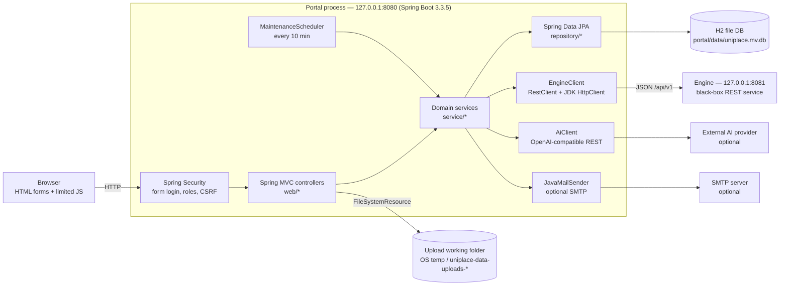
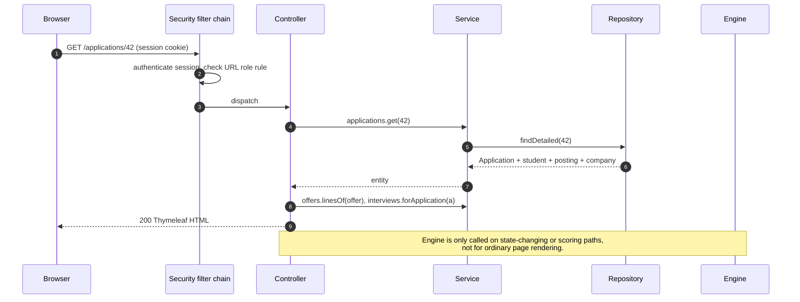
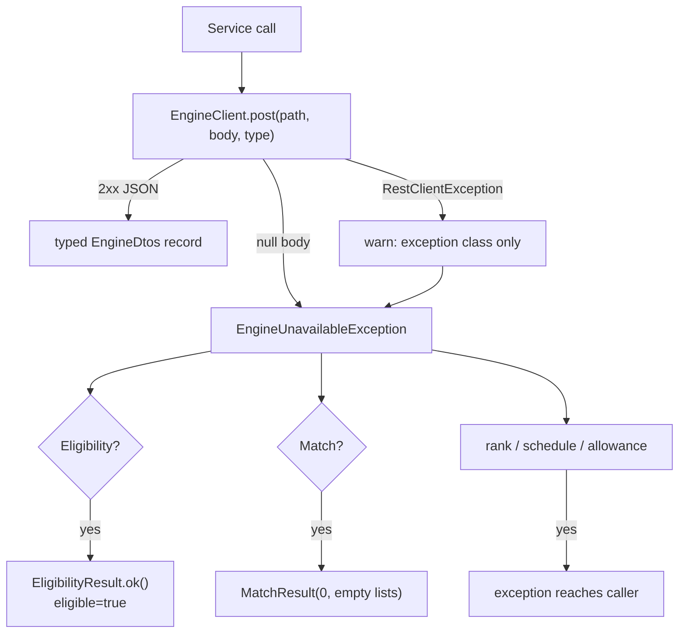
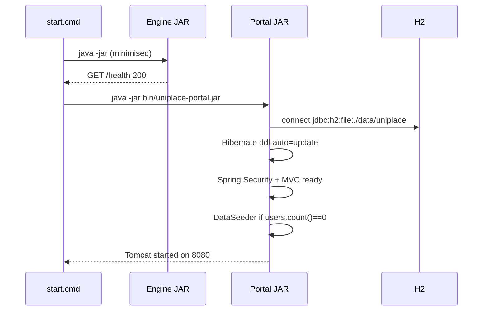

# 01 — Architecture

## Overview

UniPlace is a two-process system. The Portal is a server-rendered Spring Boot monolith backed by an embedded H2 database; the Engine is a stateless HTTP service that evaluates eligibility, match scores, candidate ranking, interview slots, and allowance statements. Both bind to loopback only.

## Process and port topology

| Component | Bind address | Port | Evidence |
| --- | --- | --- | --- |
| Portal | `127.0.0.1` | `8080` | `portal/src/main/resources/application.properties:2-3` |
| Engine | `127.0.0.1` | `8081` | `start.cmd:2`, `engine/openapi.yaml:10-11`; runtime `logs/engine.log` |
| H2 | File, embedded | n/a | `application.properties:6` |
| H2 console | Disabled | n/a | `application.properties:12`; runtime 404 for `/h2-console/login.jsp` |

The start script checks `GET /api/v1/health` before deciding whether an Engine is already running (`start.cmd:41-52`, `:70-84`). If no Engine answers, it starts `java -jar engine/uniplace-engine.jar` minimised and redirects output to `logs/engine.log` (`start.cmd:46`).

## Layering

| Layer | Package | Responsibility | Example |
| --- | --- | --- | --- |
| Configuration | `config` | Security chain, clock, demo data seeding | `SecurityConfig`, `ClockConfig`, `DataSeeder` |
| Web | `web` | Route mapping, form binding, view model, redirects, flash messages | `ApplicationController`, `PostingController` |
| Security adapter | `security` | Current authenticated user, user-details loading, failed-login counters | `CurrentUser`, `PortalUserDetailsService`, `LoginAttemptService` |
| Service | `service` | Business rules, transactions, authorisation guards, orchestration | `ApplicationService`, `OfferService`, `AccessGuard` |
| Engine adapter | `engine` | DTOs, request mapping, HTTP client, score cache, ranking | `EngineClient`, `EngineRequestMapper`, `MatchScoreService`, `RankingService` |
| AI adapter | `ai` | Prompting, provider client, parsing, cache, simulated fallback | `AiAssistantService`, `AiClient`, `PromptBuilder` |
| Persistence | `repository` | Spring Data interfaces and JPQL/entity graphs | `ApplicationRepository`, `PostingRepository` |
| Domain | `domain` | JPA entities and enums | `Student`, `Posting`, `Application`, `Offer` |

Controllers do not call repositories directly except in a few read-only or convenience paths: `AccountController` uses `NotificationService`; `StudentController` injects `StudentDocumentRepository` and `ApplicationRepository` (`StudentController.java:41-42`); `CoordinatorController` injects `NotificationRepository` (`CoordinatorController.java:49`); `HomeController` injects `ApplicationRepository`, `OfferRepository`, and `InterviewRepository` (`HomeController.java:35-38`). This is a mild layering leak but not a functional break.

## Request lifecycle

### Typical Engine-dependent flows

| Flow | Entry point | Engine call | Failure behaviour |
| --- | --- | --- | --- |
| Submit application | `POST /postings/{id}/apply` → `ApplicationService.submit` | `POST /eligibility`, then `POST /match` through `MatchScoreService` | Eligibility fails open (`eligible=true`); match returns score 0. |
| Candidate ranking | `GET /recruiter/postings/{id}/candidates` → `RankingService.rank` | `POST /rank` | `EngineUnavailableException` propagates as an error; controller catches only `BusinessRuleException` (`PostingController.java:203-208`). |
| Schedule interview | `POST /applications/{id}/interview` → `InterviewService.schedule` | `POST /schedule/validate` | Exception propagates; the POST returns an error page rather than a flash message. |
| Issue offer | `POST /applications/{id}/offer` → `OfferService.issue` | none at issue time | n/a |
| Accept offer | `POST /offers/{id}/accept` → `OfferService.accept` | `POST /allowance` via `tryComputeAllowance` | Engine failure is swallowed; allowance total/lines set to `null`. |
| Agreement / recalculate | coordinator actions → `OfferService.recordAgreement` / `recalculate` | `POST /allowance` | `EngineUnavailableException` propagates. |
| Seed data | `DataSeeder.run` | `POST /match` and `POST /allowance` | First failure flips `engineReachable=false`; remaining scores are estimated locally. |

## Engine adapter design

`EngineClient` builds a `RestClient` per call from a cloned builder, a JDK `HttpClient` with HTTP/1.1, a 3-second connect timeout, and a 10-second read timeout (`EngineClient.java:35-57`, `:59-68`). All `RestClientException`s are logged by class name and converted to `EngineUnavailableException` (`:70-85`).

`EngineRejectedException` exists but is never thrown or caught in main code (`engine/EngineRejectedException.java`; search of the tree shows no usage). Engine 4xx responses therefore also become `EngineUnavailableException` because `RestClientException` covers them.

## Transaction boundaries

| Boundary | Behaviour | Evidence |
| --- | --- | --- |
| Controller reads | Many views are `@Transactional(readOnly = true)` to keep lazy entities usable while rendering. | `ApplicationController.java:77-104`, `PostingController.java:74-94` |
| Service commands | `@Transactional` on submit, shortlist, reject, withdraw, issue, accept, decline, schedule, cancel, settings changes. | `ApplicationService.java:134-244`; `OfferService.java:95-204`; `InterviewService.java:54-129` |
| Open Session in View | Enabled, so templates can still trigger lazy loads outside a service transaction. | `application.properties:10` |
| Optimistic locking | No `@Version` fields on entities; no optimistic-lock retry. | `domain/*.java` |
| Pessimistic lock | One repository method uses `PESSIMISTIC_WRITE`, but offer acceptance does not call it. | `PostingRepository.java:52-54`; `OfferService.java:134-164` |

The combination of no `@Version`, open-in-view, and an unused pessimistic lock is relevant to concurrency hypotheses in `07-hypotheses.md`.

## Scheduling and background work

`MaintenanceScheduler` runs 20 seconds after start and then every 600 seconds (10 minutes), calling `closeExpired`, `expireOverdue`, and `sendReminders` (`MaintenanceScheduler.java:8-25`). It is enabled by default and can be disabled with `uniplace.scheduler.enabled=false`; the test profile does so (`portal/src/test/resources/application.properties`).

| Job | Effect | Evidence |
| --- | --- | --- |
| `PostingService.closeExpired` | Sets OPEN postings with deadline before today to CLOSED. | `PostingService.java:174-180` |
| `OfferService.expireOverdue` | Sets PENDING offers past `respondBy` to EXPIRED; moves OFFERED applications to WITHDRAWN; notifies both sides. | `OfferService.java:237-256` |
| `OfferService.sendReminders` | Sends one reminder per PENDING offer inside the 24-hour window, but does not persist `reminderSent=true`. | `OfferService.java:258-273`; `Offer.java:52` |

The scheduler is single-instance in-process. There is no distributed lock or leader election.

## Startup sequence

Measured on 2026-11-14: Engine ready in about 1.9 s; Portal `Started UniPlaceApplication in 18.602 seconds (process running for 19.614)`; seed log at `11:53:00` (`logs/baseline-startup.log`). Hibernate repository scan found 11 JPA repository interfaces.

`DataSeeder` is guarded by `uniplace.seed.enabled=true` and exits early when `users.count() > 0` (`DataSeeder.java:63-65`, `:131-136`). It is therefore a first-run seeder, not an idempotent reset.

## Runtime configuration coupling

| Coupling | Consequence | Evidence |
| --- | --- | --- |
| `EngineClient` captures `settings.engineBaseUrl()` in its constructor | Changing `engine.baseUrl` through Settings updates the database but not the already-constructed client; a restart is required. | `EngineClient.java:48-50`; `SettingsService.java:130-132` |
| `DocumentService` resolves `uniplace.upload-dir` to `getFileName()` and then creates an OS temp directory | The configured `./data/uploads` path is not used as written; uploads live under the OS temp directory. | `DocumentService.java:46`, `:109-116` |
| `DataSeeder` reuses `DocumentService.uploadDir()` | Seeded documents and user uploads share the same temp folder. | `DataSeeder.java:128`, `:367-379` |
| `SettingsService` caches three values in static `volatile` fields with no invalidation | Coordinator changes to active limits or shortlist threshold do not affect a running JVM. | `SettingsService.java:101-124` |
| `AuditService.lastEntry` is an instance field | De-duplication is per JVM, not per user session or cluster-wide. | `AuditService.java:25-36` |

## Error handling architecture

`WebExceptionHandler` maps `ForbiddenException` to HTTP 403 with `denied.html` and `NotFoundException` to HTTP 404 with `not-found.html` (`WebExceptionHandler.java:10-23`). `BusinessRuleException` is not handled globally; controllers catch it selectively and turn it into flash messages. Uncaught runtime exceptions fall through to the Spring Boot error page, whose details are controlled by `server.error.*` settings.

| Exception | Handler | Result |
| --- | --- | --- |
| `ForbiddenException` | `WebExceptionHandler` | 403 page |
| `NotFoundException` | `WebExceptionHandler` | 404 page |
| `BusinessRuleException` | controller-local `try/catch` | redirect + flash error, or form re-render |
| `EngineUnavailableException` | not handled globally | error page on rank/schedule/recalculate paths |
| `AiUnavailableException` | controller-local `try/catch` | flash/`aiError` message |
| Other runtime exception | Spring Boot default error handling | error page; stack trace exposure depends on config |

## Architectural strengths and limits

**Strengths**

- Clear service layer with centralised ownership checks in `AccessGuard`.
- Engine failures on the application-submission path are deliberately fail-open, avoiding blocking students when the auxiliary service is down.
- Explicit state machine for application transitions (`ApplicationStateMachine.java:21-45`).
- Server-side validation duplicates most browser constraints (file size/type, password policy, numeric bounds).
- Test profile fully isolates storage and disables seeding/scheduling.

**Limits**

- The Engine is both a rule authority and a dependency; its contract is only partially honoured by the implementation (see `04-http-and-engine-api.md`).
- Several controllers perform ownership checks inconsistently; the read paths are the weakest.
- In-memory caches (`MatchScoreService`, `FeedbackCache`, `SettingsService`, `DocumentService`) are unbounded or never invalidated.
- No database migrations (Flyway/Liquibase); schema evolution relies on `ddl-auto=update`.
- No structured audit trail for reads; only selected administrative/write actions are recorded.

## Open questions

- Is the Engine expected to be a trusted internal component whose contract deviations are acceptable, or an independently acceptance-tested deliverable?
- Should application submission remain fail-open when the Engine is down, or should it fail closed?
- Is the system intended to run as a single instance only? No clustering, shared cache, or session store is configured.
- How should `reminderSent` be persisted so that the 10-minute scheduler does not resend reminders?
- Is the H2 file database the intended production store, or only a demonstration convenience?
- Which HTTP client behaviour is expected for Engine 4xx responses: validation feedback to the user, or the current "unavailable" treatment?
