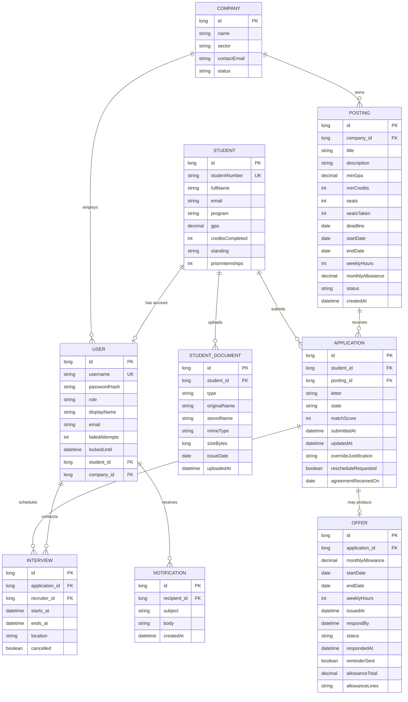
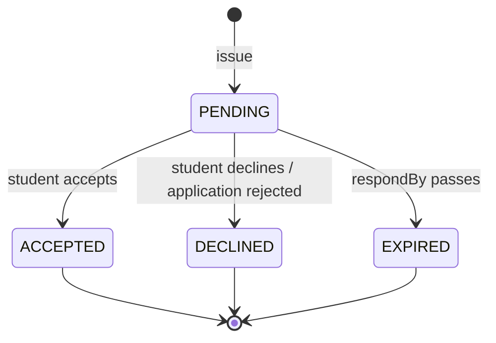

# 02 — Domain model

## Model summary

The persistence model is a small, explicit JPA model with eight entities plus collection tables. There are no inheritance hierarchies, no embeddables, and no `@Version` columns.

## Entity reference

| Entity | Table | Key fields and constraints | Evidence |
| --- | --- | --- | --- |
| `Company` | `companies` | `name` required ≤120, `sector` required ≤80, `contactEmail` required ≤120, `status` enum default PENDING. | `Company.java:12-51` |
| `User` | `users` | `username` unique ≤60, BCrypt hash ≤100, role enum, display name ≤120, optional email, failed-attempt counter, lock timestamp, one-to-one student, many-to-one company. | `User.java:17-83` |
| `Student` | `students` | `studentNumber` unique 8 chars, name/email/program required, GPA precision 3 scale 2, credits, standing enum, skills element collection, prior internships. | `Student.java:21-92` |
| `StudentDocument` | `student_documents` | Type enum, original name ≤200, stored UUID name ≤80, MIME ≤100, size bytes, optional issue date, upload timestamp. | `StudentDocument.java:17-72` |
| `Posting` | `postings` | Company many-to-one, title ≤150, description ≤4000, required and nice-to-have skill collections, min GPA, min credits, seats and seats taken, dates, weekly hours, monthly allowance, status default DRAFT. | `Posting.java:24-128` |
| `Application` | `applications` | Student and posting many-to-one, letter ≤2000, state enum default SUBMITTED, match score, submitted/updated timestamps, override justification ≤1000, reschedule flag, agreement date. Indexed on student, posting, state. | `Application.java:18-86` |
| `Offer` | `offers` | One-to-one application, allowance and dates, weekly hours, issued/response timestamps, status enum default PENDING, responded timestamp, reminder flag, computed total and JSON lines. | `Offer.java:18-92` |
| `Interview` | `interviews` | Application and recruiter many-to-one, `starts_at`/`ends_at` required, location ≤200, cancelled flag. | `Interview.java:14-61` |
| `Notification` | `notifications` | Recipient many-to-one, subject ≤200, body ≤2000, created timestamp, recipient index. | `Notification.java:15-50` |

## Collection tables

| Owner | Table | Columns | Ordering | Evidence |
| --- | --- | --- | --- | --- |
| `Student.skills` | `student_skills` | `student_id`, `skill` (≤60), `position` | `@OrderColumn` | `Student.java:50-54` |
| `Posting.requiredSkills` | `posting_required_skills` | `posting_id`, `skill` (≤60), `position` | `@OrderColumn` | `Posting.java:41-45` |
| `Posting.niceToHaveSkills` | `posting_nice_skills` | `posting_id`, `skill` (≤60), `position` | `@OrderColumn` | `Posting.java:47-51` |

Both skill collections are `FetchType.EAGER`, so every posting load also loads all skill rows. This is acceptable at demonstration scale but is a query-volume risk at the 10,000-application volume described in `TestDataService`.

## Enumerations

| Enum | Values | Semantics | Evidence |
| --- | --- | --- | --- |
| `Role` | `STUDENT`, `RECRUITER`, `COORDINATOR` | Portal authorisation role. | `Role.java` |
| `Standing` | `GOOD`, `PROBATION` | Derived from GPA; PROBATION when GPA < 2.00. | `Standing.java:5-12` |
| `CompanyStatus` | `PENDING`, `APPROVED`, `SUSPENDED` **[INFERRED from usage]** | Controls visibility and application freezes. | `Company.java:29-31`; `CompanyService.java:79-106` |
| `PostingStatus` | `DRAFT`, `OPEN`, `CLOSED`, `FILLED` | Lifecycle of a posting. | `Posting.java:76-78`; `PostingService.java:136-180` |
| `ApplicationState` | `SUBMITTED`, `SHORTLISTED`, `INTERVIEW`, `OFFERED`, `ACCEPTED`, `REJECTED`, `WITHDRAWN` | Application lifecycle; `ACTIVE` = first four. | `ApplicationState.java:6-13` |
| `OfferStatus` | `PENDING`, `ACCEPTED`, `DECLINED`, `EXPIRED` | Offer response state. | `Offer.java:46-48`; `OfferService.java:238-243` |
| `DocumentType` | `CV`, `TRANSCRIPT` | Uploaded document kind. | `DocumentType.java` |

## Relationships and cardinalities

| Relationship | Cardinality | Ownership / fetch | Notes |
| --- | --- | --- | --- |
| `Company` → `Posting` | 1:N | Posting owns `@ManyToOne(optional=false)`, LAZY | A company can have many postings. |
| `Company` → `User` | 1:N | User owns `@ManyToOne`, LAZY | Recruiters may have no company; `recruiter.newco` does. |
| `Student` ↔ `User` | 1:1 | User owns `@OneToOne`, LAZY | Students have one account; generated volume students have none. |
| `Student` → `StudentDocument` | 1:N | Document owns `@ManyToOne`, LAZY | One CV and one transcript per student enforced in service, not by a unique constraint. |
| `Student` → `Application` | 1:N | Application owns `@ManyToOne`, LAZY | Indexed by `student_id`. |
| `Posting` → `Application` | 1:N | Application owns `@ManyToOne`, LAZY | Indexed by `posting_id`. |
| `Application` → `Offer` | 1:0..1 | Offer owns `@OneToOne(optional=false)`, LAZY | Service enforces one offer per application. |
| `Application` → `Interview` | 1:N | Interview owns `@ManyToOne`, LAZY | Multiple interviews per application are possible after cancellation and rescheduling. |
| `User` → `Interview` | 1:N | Interview owns `@ManyToOne`, LAZY | Recruiter conducting the interview. |
| `User` → `Notification` | 1:N | Notification owns `@ManyToOne`, LAZY | Indexed by `recipient_id`. |

### Missing database-level uniqueness

| Intended invariant | Enforced in code | Enforced in schema |
| --- | --- | --- |
| One offer per application | `offers.findByApplication(a).isPresent()` in `issue` | No unique constraint on `offers.application_id` |
| One CV and one transcript per student | Replaced in `DocumentService.upload` | No unique `(student_id, type)` constraint |
| One user per student | Seeder/service pairing | No unique constraint on `users.student_id` |
| No duplicate application per student/posting | `existsByStudentAndPostingAndStateNot(..., WITHDRAWN)` | No unique constraint; withdrawn applications can be duplicated |
| One active placement per student | Not enforced globally | No constraint |

The service checks are valid for normal single-request flows but do not protect against concurrent requests.

## Application lifecycle

```mermaid
stateDiagram-v2
    [*] --> SUBMITTED: submit
    SUBMITTED --> SHORTLISTED: shortlist
    SUBMITTED --> REJECTED: reject
    SUBMITTED --> WITHDRAWN: withdraw
    SHORTLISTED --> INTERVIEW: schedule
    SHORTLISTED --> REJECTED: reject
    SHORTLISTED --> WITHDRAWN: withdraw
    INTERVIEW --> OFFERED: issue offer
    INTERVIEW --> SHORTLISTED: cancel interview
    INTERVIEW --> REJECTED: reject
    INTERVIEW --> WITHDRAWN: withdraw
    OFFERED --> ACCEPTED: accept offer
    OFFERED --> REJECTED: decline offer / reject
    OFFERED --> WITHDRAWN: withdraw / offer expiry
    ACCEPTED --> [*]
    REJECTED --> [*]
    WITHDRAWN --> [*]
```

The transition table is explicit in `ApplicationStateMachine.java:21-31`. `ASSERT` failures produce a `BusinessRuleException` with the from/to states (`:40-45`).

| From | Allowed to | Evidence |
| --- | --- | --- |
| SUBMITTED | SHORTLISTED, REJECTED, WITHDRAWN | `ApplicationStateMachine.java:24` |
| SHORTLISTED | INTERVIEW, REJECTED, WITHDRAWN | `:25` |
| INTERVIEW | OFFERED, SHORTLISTED, REJECTED, WITHDRAWN | `:26` |
| OFFERED | ACCEPTED, REJECTED, WITHDRAWN | `:27` |
| ACCEPTED | none | `:28` |
| REJECTED | none | `:29` |
| WITHDRAWN | none | `:30` |

## Offer lifecycle

`OfferService.issue` sets the application to OFFERED and computes `respondBy` from `responseDeadline` (`OfferService.java:120-124`). `accept` increments seats and may mark the posting FILLED (`:145-155`). `decline` sets the application to REJECTED (`:174-176`). `expireOverdue` moves OFFERED applications to WITHDRAWN (`:242-247`).

## Posting lifecycle

| Status | Entered by | Left by | Visibility |
| --- | --- | --- | --- |
| DRAFT | `PostingService.create` default | `publish` | Not visible to students; visible to owning recruiters. |
| OPEN | `publish` (company APPROVED, deadline not past) | `close`, `closeExpired`, automatic FILLED when seats reach 0 | Visible while company approved. |
| CLOSED | `close`, `closeExpired` | No transition | Visible to students for 7 days after deadline. |
| FILLED | `OfferService.accept` when `seatsLeft()==0` | No transition | Visible for 7 days after deadline. |

Evidence: `Posting.java:76-78`; `PostingService.java:148-180`; `PostingService.java:57-66`; `OfferService.java:153-155`.

## Entity invariants observed in code

| Invariant | Where enforced | Strength |
| --- | --- | --- |
| GPA is 0.00–4.00 | `StudentService.checkAcademic`, `PostingService.apply` for min GPA | Service-level |
| Credits are 0–140 | `StudentService.checkAcademic` | Service-level |
| Prior internships are 0–20 | `StudentService.checkAcademic` | Service-level |
| Posting title non-blank ≤150 | `PostingService.apply` | Service-level |
| Posting description non-blank ≤4000 | `PostingService.apply` | Service-level |
| At least one required skill | `PostingService.apply` | Service-level |
| Seats 1–20 | `PostingService.apply` | Service-level |
| Internship 4 weeks–6 months | `PostingService.apply` | Service-level |
| Weekly hours 10–40 | `PostingService.apply` and `OfferService.issue` | Service-level |
| Allowance 0–5000 | `PostingService.apply`; offer ≤ posting allowance | Service-level |
| Motivation letter 100–2000 | `ApplicationService.submit` | Service-level |
| Interview end after start | `InterviewService.schedule` before Engine call | Service-level |
| Password ≥10 with a digit | `UserService.checkPassword`, but `changePassword` only checks length | Service-level, inconsistent |
| Username 3–60 `[a-z0-9._-]` | `UserService.create` / `assertUsernameAvailable` | Service-level |
| Student number exactly 8 digits | `StudentService.create` | Service-level |
| Company name unique | `CompanyService.validate` | Service-level, case-sensitive DB check **[INFERRED]** |
| One active application per posting | `ApplicationService.submit` excludes WITHDRAWN only | Service-level, partial |
| Active application limit | `ApplicationService.submit` + `countActive` | Service-level, counts WITHDRAWN |

## Persistence notes

- `spring.jpa.hibernate.ddl-auto=update` means the schema is created/updated by Hibernate at runtime; there are no migration scripts (`application.properties:9`).
- `spring.jpa.open-in-view=true` keeps the persistence context open during rendering (`:10`).
- `hibernate.jdbc.time_zone=Asia/Qatar` sets the JDBC time zone (`:11`); the application clock is also Asia/Qatar (`:24`).
- The H2 URL includes `LOCK_TIMEOUT=10000` (`:6`), relevant because the file database is single-writer.
- Seeded documents are written directly to the upload folder, not through `DocumentService.upload` (`DataSeeder.java:367-379`), so they bypass MIME magic checks but still carry `application/pdf`.
- `Student.skills` and posting skill lists are EAGER; `Application`/`Offer`/`Interview` associations are LAZY and often rely on open-in-view or entity graphs.

## Open questions

- Is a student allowed to hold more than one ACCEPTED application? No global rule prevents it.
- Should `CompanyStatus.SUSPENDED` be a terminal state, or can a suspended company be re-approved? `approve` accepts any company id.
- What should happen to existing offers and interviews when a company is suspended? Current code only freezes certain transitions.
- Is `ApplicationState.ACCEPTED` meant to mean "placement confirmed", or only "offer accepted pending agreement"? The model stores both `ACCEPTED` and `agreementReceivedOn`, suggesting two stages.
- Why is there no unique constraint for one offer per application or one document per type?
- Should `seatsTaken` be recomputed from accepted offers rather than incrementally maintained?
- Are generated volume students intentionally account-less, and should they appear in coordinator user counts? They do not create `User` rows (`TestDataService.java:81-90`).
