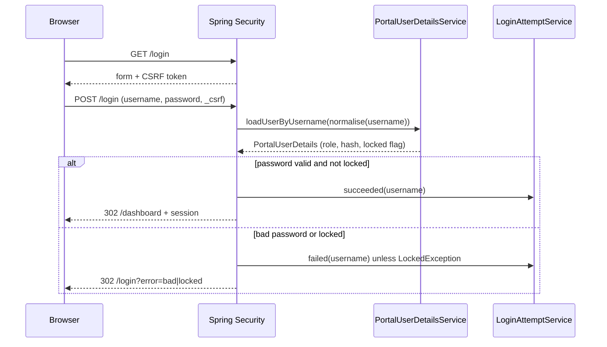

# 05 — Security

## Security model

| Control | Implementation | Evidence |
| --- | --- | --- |
| Authentication | Spring Security form login at `/login`, username/password | `SecurityConfig.java:35-49` |
| Password hashing | BCrypt | `SecurityConfig.java:17-20` |
| Authorisation | URL-prefix role rules plus controller/service ownership checks | `SecurityConfig.java:26-34`; `AccessGuard.java` |
| CSRF | Enabled by default, except `/coordinator/settings/**` | `SecurityConfig.java:25` |
| Session | Servlet session, 30-minute timeout, `JSESSIONID` | `application.properties:4`; `SecurityConfig.java:50-54` |
| Logout | Spring Security `/logout` invalidates session; UI uses custom `/account/logout` | `SecurityConfig.java:50-54`; `AccountController.java:51-59` |
| Lockout | 5 failed attempts → 15-minute lock | `LoginAttemptService.java:14-39`; `PortalUserDetails.java:18-25` |
| Access-denied page | `/denied`, HTTP 403 | `SecurityConfig.java:55`; `HomeController.java:82-86` |
| Error detail | Stack trace, message and exception included | `application.properties:19-22` |

## Authentication flow



Evidence: `SecurityConfig.java:35-49`; `PortalUserDetailsService.java:25-31`; `PortalUserDetails.java:18-25`, `:47-50`.

### Login behaviour details

| Detail | Behaviour | Evidence |
| --- | --- | --- |
| Username normalisation | Trim + lower-case before lookup | `UserService.java:30-33`; `PortalUserDetailsService.java:28` |
| Failure counter | Incremented only when the user exists and is not already locked | `LoginAttemptService.java:25-39` |
| Lock threshold | Fifth failure sets `lockedUntil = now + 15 min` and resets the counter to 0 | `:32-37` |
| Lock enforcement | `isAccountNonLocked()` false while `lockedUntil > now` | `PortalUserDetails.java:25`, `:47-50` |
| Success | Clears failed attempts and lock | `LoginAttemptService.java:41-46` |
| Error messages | Generic "Wrong username or password" or lock message | `HomeController.java:67-75` |
| CSRF on login | Default Spring Security protection; Thymeleaf adds hidden `_csrf` | `login.html:11` |
| Session fixation | Spring Security default session-ID change on authentication | **[INFERRED]** framework default, not overridden |

### Password policy

| Path | Rule | Evidence |
| --- | --- | --- |
| Create user/student | ≥10 characters and at least one digit; username `[a-z0-9._-]{3,60}` | `UserService.java:18-20`, `:35-40`, `:54-68` |
| Change password | Current password must match; new password only ≥10 characters | `UserService.java:70-80` |
| Change confirmation | New and confirmation must match | `AccountController.java:35-41` |

The change-password path does **not** require a digit, unlike account creation. The seeded accounts all share the published password `Uniplace!2026` (`DataSeeder.java:68`, `README.md:102-116`). There is no password-reset, MFA, e-mail verification, or forced first-login change.

## Authorisation matrix

`✓` = allowed by the URL rule, `—` = blocked by the URL rule, `G` = allowed only after an application-level guard, `?` = no explicit controller guard.

| Resource | Anonymous | Student | Recruiter | Coordinator | Evidence |
| --- | --- | --- | --- | --- | --- |
| `/login`, `/css/**`, `/js/**`, `/favicon.ico`, `/error` | ✓ | ✓ | ✓ | ✓ | `SecurityConfig.java:27` |
| `/dashboard` | — | ✓ | ✓ | ✓ | `anyRequest().authenticated()` |
| `/postings`, `/postings/{id}` | — | ✓ | ✓ | ✓ | `:34`; controller visibility |
| `/applications`, `/applications/{id}` | — | ✓ | ✓ | ✓ | `:34`; **no ownership guard on detail** |
| `/student/**` | — | ✓ | — | — | `:33` |
| `/recruiter/**` | — | — | ✓ | — | `:32` |
| `/documents/{id}` | — | G | G (any recruiter) | ✓ | `:34`; `StudentController.java:99-105` |
| `/notifications` | — | ✓ | ✓ | ✓ | `:34` |
| `/account/**` | — | ✓ | ✓ | ✓ | `:34` |
| `/coordinator/students/**`, `/companies/**`, `/users/**`, `/applications/**`, `/offers/**`, `/outbox/**`, `/tools/**` | — | — | — | ✓ | `:28-31` |
| `/coordinator/audit/**`, `/coordinator/settings/**` | — | — | — | ✓ | `:28-31` |
| `/coordinator/reports/**` | — | — | — | ✓ | covered by `anyRequest` + controller role assumption; **no explicit matcher** |

Runtime confirmation: student and recruiter requests to coordinator URLs returned 403; anonymous requests to protected and non-existent paths returned 302 to `/login` (`portal-probe-results.txt`).

### Guard coverage by controller

| Controller | Ownership guard coverage | Evidence |
| --- | --- | --- |
| `StudentController` | Profile/upload are self-scoped; download allows any recruiter | `StudentController.java:57-115` |
| `ApplicationController` | Writes call service guards; `view` does not | `ApplicationController.java:97-104` vs `:119-256` |
| `PostingController` | Detail/edit/publish/close/candidates guarded; **update is not** | `PostingController.java:149-211` |
| `CompanyController` | Service uses current user's company | `CompanyService.java:66-77` |
| `CoordinatorController` | URL role rule only; appropriate for coordinator scope | `CoordinatorController.java` |
| `SettingsController` | URL role rule only; appropriate for coordinator scope | `SettingsController.java` |
| `AccountController` | Self-scoped | `AccountController.java` |

## Confirmed access-control findings

### F-01 — Any recruiter can download any student document

`StudentController.download` permits:

```java
boolean allowed = user.is(Role.COORDINATOR)
        || (user.is(Role.STUDENT) && user.getStudent() != null
            && Objects.equals(user.getStudent().getId(), d.getStudent().getId()))
        || user.is(Role.RECRUITER);
```

Evidence: `StudentController.java:99-105`.

The recruiter branch has no company, posting, or application relationship check. Runtime probe as `recruiter.qtech`, `recruiter.desertbloom` (PENDING company), and `recruiter.newco` (no company) returned **200 `application/pdf`** for document ids 1–4; the owning student received 200 for 1–2 and 403 for 3–4 (`portal-probe-results-2.txt`). This is a confirmed horizontal privilege escalation.

### F-02 — Application detail has no ownership guard

`GET /applications/{id}` loads any application and renders it without calling `AccessGuard`:

```java
Application a = applications.get(id);
fill(model, user, a);
return "applications/view";
```

Evidence: `ApplicationController.java:97-104`.

The view displays the student's name, program, GPA, credits, motivation letter, interviews, offer terms, and actions. Any authenticated user can request an arbitrary id. This is source-evident; a runtime cross-account probe is proposed in `07-hypotheses.md`.

### F-03 — Posting update lacks ownership guard

`POST /recruiter/postings/{id}` calls `postings.update(id, form)` without `guard.assertRecruiterOwns(...)`, unlike edit/publish/close:

```java
postings.update(id, form);
```

Evidence: `PostingController.java:160-171`; contrast `:149-158`, `:173-175`, `:185-187`.

`PostingService.update` also has no user parameter (`PostingService.java:136-146`). Any recruiter can therefore modify any editable posting if they know its id. This is source-evident.

### F-04 — CSRF exemption on settings

`/coordinator/settings/**` is excluded from CSRF protection (`SecurityConfig.java:25`). Runtime probe: a coordinator `POST /coordinator/settings` without a `_csrf` token returned **302** to the settings page, not 403. The same applies to `/coordinator/settings/test-ai`. Impact is bounded by the coordinator role rule, but a cross-site request from a logged-in coordinator can change settings, including the Engine URL, AI key, and SMTP credentials.

### F-05 — Custom logout does not invalidate the session

The UI posts to `/account/logout` (`layout.html:42`). That handler only expires the browser cookie:

```java
Cookie cookie = new Cookie("JSESSIONID", "");
cookie.setMaxAge(0);
response.addCookie(cookie);
return "redirect:/login?logout";
```

Evidence: `AccountController.java:51-59`.

The server-side `HttpSession` is not invalidated and the Spring Security context is not explicitly cleared. If the session id is retained or replayed, it may remain valid until the 30-minute idle timeout. This is source-evident; confirmation requires replaying a captured cookie after logout. Spring Security's own `/logout` (`SecurityConfig.java:50-54`) does invalidate the session, but the UI does not use it.

### F-06 — Stored XSS through company name

`postings/list.html:29` renders the company name with `th:utext`, which does not escape HTML:

```html
<td th:utext="${p.company.name}">company</td>
```

Company names are only checked for non-blank length and uniqueness (`CompanyService.java:114-130`); a recruiter can register a name containing HTML/JavaScript. The value is shown on the student posting list. This is source-evident; no runtime payload was submitted. All other reviewed templates use `th:text` for user data, including the motivation letter (`applications/view.html:21`).

### F-07 — Sensitive settings may be logged in clear text

`SettingsController.save` masks secrets for the audit record but logs raw old/new values:

```java
log.info("Setting {} changed from '{}' to '{}' by {}", c.getKey(), old, c.getValue(), username);
```

Evidence: `SettingsController.java:113-119`.

For `ai.apiKey` and `smtp.password`, this writes the secret to the application log. The form and audit entry are masked (`:115-117`, `:160-165`), so the log line is the outlier. This is source-evident; no real secret was present during probing.

### F-08 — Error responses can expose internals

`server.error.include-stacktrace=always`, `include-message=always`, `include-exception=true` (`application.properties:19-22`). Any unhandled exception returns exception class, message, and stack trace to the browser. The custom `error.html` may or may not render all fields; the configuration permits disclosure. This is configuration-evident; no 500 was induced in the Portal during probing.

## Additional security observations

| Observation | Detail | Evidence |
| --- | --- | --- |
| Secrets at rest | AI key and SMTP password are stored as ordinary `SettingEntry` values; no encryption layer is present | `SettingsService.java:84-95`; `SettingEntry` entity |
| AI prompt PII | Student name, student number, GPA, and raw letter are sent to the external provider | `PromptBuilder.java:42-48` |
| Prompt injection | The student-controlled letter is concatenated into the system prompt | `PromptBuilder.java:34-48` |
| File storage | Uploads go to an OS temp directory, not the configured data directory | `DocumentService.java:43-48`, `:109-116` |
| File validation | Only PDF magic bytes and a size cap; no malware scan or PDF parsing | `DocumentService.java:74-76`, `:126-133` |
| Path traversal | Stored names are UUIDs; original names are sanitised to a basename | `:85-86`, `:135-146` |
| CSV injection | Report cells are escaped for CSV syntax but not for spreadsheet formula prefixes (`=`, `+`, `-`, `@`) | `ReportService.java:109-128` |
| SQL injection | JPQL with bound parameters; no string-concatenated native SQL found | `repository/*.java` |
| Mass assignment | Forms are explicit DTOs/parameters, not bound directly to entities | `PostingForm`, `OfferForm`, controller parameters |
| Open redirect | Login success always redirects to `/dashboard`; no `returnUrl` parameter | `SecurityConfig.java:37-40` |
| Session cookie flags | Default servlet cookie is HttpOnly; Secure is not set because the app is HTTP; SameSite is not explicitly configured | **[INFERRED]** from absence of configuration |
| Security headers | Spring Security defaults apply (frame denial, content-type options, cache control); no CSP configured | **[INFERRED]** framework defaults |
| Audit coverage | Only `SHORTLIST_OVERRIDE` and `SETTING_CHANGED` are written | `ApplicationService.java:195-199`; `SettingsController.java:116` |
| Login rate limiting | Only per-account lockout; no IP throttling or CAPTCHA | `LoginAttemptService.java` |
| Account enumeration | Generic login error; but lock message reveals a valid account exists | `HomeController.java:67-75` |

## Threat-oriented view

```mermaid
flowchart TD
    Anon["Anonymous"] -->|form login| Portal
    Student["Student"] -->|own data| Portal
    Recruiter["Recruiter"] -->|company data| Portal
    Coordinator["Coordinator"] -->|all data| Portal
    Student -->|IDOR: /applications/{id}| OtherApp["Other students' applications"]
    Recruiter -->|IDOR: /documents/{id}| AllDocs["All student documents"]
    Recruiter -->|IDOR: POST /recruiter/postings/{id}| OtherPosting["Other companies' postings"]
    Coordinator -->|CSRF-exempt settings| Settings["Engine URL, AI key, SMTP"]
    Recruiter -->|company name th:utext| XSS["Stored XSS in posting list"]
```

## Security test suggestions

| Area | Suggested check | Why |
| --- | --- | --- |
| Document IDOR | Recruiter A requests document owned by student of company B | Confirmed 200; regression test |
| Application IDOR | Student A requests application of student B | Source gap; confirm at runtime |
| Posting update IDOR | Recruiter A posts to recruiter B's posting id | Source gap; confirm at runtime |
| CSRF | Cross-origin form POST to `/coordinator/settings` | Exemption confirmed; test exploitability |
| Logout | Replay cookie after `/account/logout` | Session invalidation gap |
| XSS | Register company name `` | `th:utext` sink |
| Error disclosure | Force a 500 and inspect response | `include-stacktrace=always` |
| Secret logging | Change AI key and inspect logs | Raw value logged |
| Password policy | Change password to 10 letters without a digit | Accepted by change path |
| Lockout | Five failures, correct password before/after 15 minutes | Lock semantics |
| Upload | PDF magic bytes with executable payload, oversized file, renamed extension | Validation scope |
| CSV | Company name starting with `=cmd` | Spreadsheet formula injection |

## Open questions

- Is "any recruiter may view any document" an intended recruiting workflow or an access-control defect?
- Should `/applications/{id}` be visible to coordinators only, or to the owning student/recruiter?
- Should posting updates be restricted to the owning company at the controller, service, or both?
- Why is CSRF disabled for settings? Was this for an API client that no longer exists?
- Is the custom `/account/logout` intended to replace Spring Security logout, and is session invalidation required?
- Are external AI providers allowed to receive student PII, and is there a data-processing agreement?
- Is plaintext storage of AI/SMTP secrets acceptable for the deployment model?
- Should the application log ever contain setting values, including secrets?
- Is there an expectation of security headers or a CSP that is not configured in this build?
