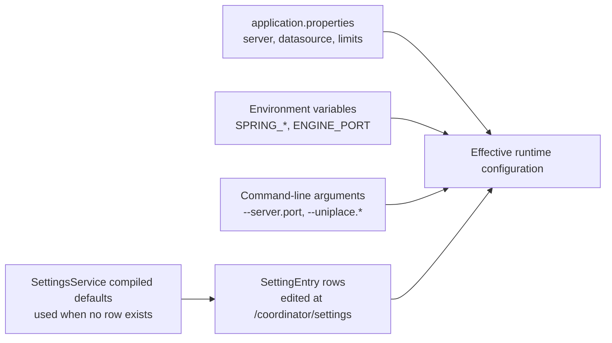

# 06 — Configuration, data, build and CI

## Configuration layers

UniPlace gets its effective configuration from four places. Later layers override earlier ones; database settings override the compiled defaults but not Spring property values that are read directly.



Evidence: `portal/src/main/resources/application.properties:1-30`; `SettingsService.java:42-65`; `start.cmd:46`, `:56-65`; `README.md:59-60`.

## Spring properties

| Property | Value | Effect | Evidence |
| --- | --- | --- | --- |
| `spring.application.name` | `uniplace-portal` | Application name in logs | `application.properties:1` |
| `server.port` | `8080` | Portal HTTP port | `:2` |
| `server.address` | `127.0.0.1` | Loopback-only binding | `:3` |
| `server.servlet.session.timeout` | `30m` | Idle session lifetime | `:4` |
| `spring.datasource.url` | `jdbc:h2:file:./data/uniplace;LOCK_TIMEOUT=10000` | File database relative to `portal/` | `:6` |
| `spring.datasource.username` / `password` | `sa` / empty | Local H2 credentials | `:7-8` |
| `spring.jpa.hibernate.ddl-auto` | `update` | Schema is created/altered at start, never dropped | `:9` |
| `spring.jpa.open-in-view` | `true` | Lazy loading allowed while rendering | `:10` |
| `spring.jpa.properties.hibernate.jdbc.time_zone` | `Asia/Qatar` | JDBC timestamp zone | `:11` |
| `spring.h2.console.enabled` | `false` | H2 web console absent; `/h2-console/**` returns 404 when authenticated | `:12`; runtime probe |
| `spring.thymeleaf.cache` | `false` | Templates re-read on every request | `:14` |
| `spring.servlet.multipart.max-file-size` | `6MB` | Servlet-level upload cap | `:16` |
| `spring.servlet.multipart.max-request-size` | `7MB` | Whole multipart request cap | `:17` |
| `server.error.whitelabel.enabled` | `false` | Custom `error.html` used | `:19` |
| `server.error.include-stacktrace` / `message` / `exception` | `always` / `always` / `true` | Error page may disclose internals | `:20-22` |
| `uniplace.zone` | `Asia/Qatar` | Clock zone for all business dates | `:24`; `ClockConfig.java:11-16` |
| `uniplace.seed.enabled` | `true` | Demonstration data loaded on an empty database | `:25`; `DataSeeder.java:64` |
| `uniplace.upload-dir` | `./data/uploads` | Intended upload directory | `:26` |
| `uniplace.engine.default-url` | `http://127.0.0.1:8081/api/v1` | Initial Engine URL setting | `:27`; `SettingsService.java:55` |
| `logging.level.root` | `INFO` | Normal application logging | `:29` |
| `logging.level.org.hibernate.SQL` | `WARN` | SQL statements suppressed | `:30` |

There is no profile-specific property file (`application-*.properties`) in the source tree, so development and production use the same configuration unless arguments or environment variables are supplied. **[INFERRED]** from the absence of such files.

### Runtime settings stored in the database

`SettingsService` defines 20 keys and their defaults. Only `engine.baseUrl` is seeded from a Spring property; the rest are literal defaults. A coordinator can edit all of them at `/coordinator/settings`.

| Key | Default | Used by | Evidence |
| --- | --- | --- | --- |
| `limits.active.good` | `5` | Active-application limit for good standing | `SettingsService.java:45`, `:105-110` |
| `limits.active.probation` | `2` | Active-application limit for probation | `:46`, `:112-117` |
| `shortlist.threshold` | `60` | Default Engine match-score cut-off | `:47`, `:119-124` |
| `offer.response.hours` | `72` | Offer acceptance window | `:48`, `:126-128` |
| `posting.default.minGpa` | `2.00` | Default posting minimum GPA | `:49` |
| `posting.default.minCredits` | `45` | Default posting minimum credits | `:50` |
| `allowance.transport` | `300` | Monthly transport supplement | `:51` |
| `allowance.monthlyCap` | `5000` | Allowance cap | `:52` |
| `allowance.penaltyRate` | `0.05` | Late-payment daily penalty rate | `:53` |
| `allowance.penaltyCap` | `0.20` | Penalty cap as a fraction | `:54` |
| `engine.baseUrl` | `uniplace.engine.default-url` | Base URL for all Engine calls | `:55`, `:130-132` |
| `ai.provider` | `openai` | AI provider selector | `:56` |
| `ai.baseUrl` | empty | AI provider endpoint | `:57` |
| `ai.apiKey` | empty | AI credential | `:58` |
| `ai.model` | empty | AI model name | `:59` |
| `smtp.host` | empty | Enables e-mail when non-blank | `:60`; `NotificationService.java:43-46` |
| `smtp.port` | `587` | SMTP port | `:61` |
| `smtp.username` | empty | SMTP user | `:62` |
| `smtp.password` | empty | SMTP password | `:63` |
| `smtp.from` | `uniplace@localhost` | Envelope sender | `:64` |

Three values are cached in **static** volatile fields on first read: `maxActiveGood`, `maxActiveProbation`, and `shortlistThreshold` (`SettingsService.java:101-124`). A settings change made through the UI therefore does not affect those three until the JVM restarts; every other key is re-read from the repository on each call (`:71-74`).

## Time and locale

| Aspect | Behaviour | Evidence |
| --- | --- | --- |
| Business clock | `Clock.system(ZoneId.of("uniplace.zone"))`, default `Asia/Qatar` | `ClockConfig.java:11-16` |
| JDBC time zone | `Asia/Qatar` | `application.properties:11` |
| Seeded dates | Generated relative to `LocalDate.now(clock)` at first start | `DataSeeder.java:139-140` |
| Date format in Engine calls | `yyyy-MM-dd` and ISO-8601 date-times | `engine/openapi.yaml:5-9` |
| Server default locale | Not set, so the JVM default applies | absence of `spring.web.locale` |

## Demonstration data

`DataSeeder` is an `ApplicationRunner` conditional on `uniplace.seed.enabled=true` (`DataSeeder.java:63-65`). It does nothing when any user already exists (`:134-136`), so it is a first-start loader rather than a reconciler. Every seeded account uses the published password `Uniplace!2026` (`:68`, `README.md:104`).

### Seeded scenario

| Element | Detail | Evidence |
| --- | --- | --- |
| Coordinator | `coordinator`, Placement Office | `DataSeeder.java:142` |
| Companies | 6: QTech, Gulf Bank, Doha Energy, Lusail Health, Pearl Logistics, Desert Bloom (PENDING) | `:144-149` |
| Recruiters | 6 company recruiters plus `recruiter.newco` without a company; a second QTech recruiter is added later (8 recruiter accounts) | `:152-158`, `:275` |
| Named students | `amal`, `omar`, `khalid`, `noor`, `yousef`, plus `amna` | `:190-199`, `:279-280` |
| Generated students | Grown to 40, then `amna` makes 41 | `:206-218`, `:279` |
| Postings | 14: 9 OPEN, 2 CLOSED, 1 FILLED, 2 DRAFT | `:160-187` |
| Fixed applications | 11 covering SUBMITTED, SHORTLISTED, OFFERED, WITHDRAWN, REJECTED, ACCEPTED | `:220-232` |
| Background applications | Each remaining student gets 2–4 applications, capped by standing limit | `:243-273` |
| Offers | 3 open on QTech/Energy postings plus 2 accepted placements | `:234-241`, `:281-286` |
| Interviews | Created for every seeded `INTERVIEW` application at recruiter slots | `:397-403` |
| Notifications | One per seeded application plus offer/interview messages | `:394-396` |
| Documents | CV for most students and a transcript for every student; PDF content is a fixed stub | `:347-379` |

The fixed scenario deliberately includes edge cases: `amal` has four active applications including a `WITHDRAWN` one (`:222-225`), `noor`'s transcript is issued `today.minusDays(179)` (`:196-197`), `p2` has a deadline of `today` (`:162-163`), and `p11` is `FILLED` with one seat taken (`:181`, `:241`).

### Observed seed volume

| Table | Rows after `--reset` | How counted |
| --- | --- | --- |
| Users | 50 | runtime probe `/coordinator/users` |
| Students | 41 | runtime probe `/coordinator/students` (42 table rows including header) |
| Companies | 6 | runtime probe `/coordinator/companies` |
| Postings | 14 | runtime probe and seeder reading |
| Applications | 116 | runtime probe `/coordinator/applications` |
| Offers | 5 (2 accepted) | runtime report `/coordinator/reports/offers.csv` |
| Notifications | 118 | runtime probe `/coordinator/outbox` |
| Audit entries | 1 | runtime probe `/coordinator/audit` |

The application count is generated by a seeded `Random(2026)` (`DataSeeder.java:103`), so the volume is reproducible for a given date and code version. **[INFERRED]** because the loop conditions depend on `today` through posting deadlines and states.

### Test data generator

`TestDataService.generate` creates synthetic students, postings, applications, and notifications for volume testing (`TestDataService.java:31-34`, `:67-71`). It accepts 1–10,000 per run (`:38`, `:69-71`), derives `count/10` students and `count/50` postings, and marks generated records with the `Generated` prefix (`:82-97`). Generated students have no login accounts (`:31-34`). This path is coordinator-only (`SecurityConfig.java:28-31`; `CoordinatorController.java:263-273`).

## Persistence and data lifecycle

| Concern | Behaviour | Evidence |
| --- | --- | --- |
| Database engine | H2 in file mode | `application.properties:6-8` |
| Schema management | Hibernate `ddl-auto=update`; no migration tool | `:9` |
| Seed trigger | Empty `users` table only | `DataSeeder.java:134-136` |
| Reset | `start.cmd --reset` deletes the whole `portal\data` directory before start | `start.cmd:12-18` |
| Persistence across restarts | Data survives unless `--reset` is used | `README.md:61-63` |
| Database file location | `portal/data/uniplace.mv.db` | `application.properties:6`; runtime file check |
| Identifiers | JPA-generated surrogate keys; no UUID business keys | `domain/*.java` |
| Deletion | Documents delete the previous row and file on replacement; most other data is not deletable through the UI | `DocumentService.java:95-103` |

`open-in-view=true` means entities can be lazily traversed in templates, but it also keeps a persistence context open for the whole request (`application.properties:10`). No explicit transaction boundary is configured at the view layer.

### File storage

`DocumentService` ignores the directory path configured in `uniplace.upload-dir` and uses only its **file name**, creating a fresh OS temporary directory at construction:

```java
this.uploadDir = createWorkingFolder(Paths.get(uploadDir).getFileName().toString());
...
return Files.createTempDirectory("uniplace-" + name + "-");
```

Evidence: `DocumentService.java:43-48`, `:109-116`.

Consequences:

| Consequence | Detail | Evidence |
| --- | --- | --- |
| Location | Uploads live under the OS temp directory, not `portal/data/uploads` | `:109-116` |
| Lifetime | The folder is new on every JVM start, so files from a previous run are not found | `:110-112` |
| Database consistency | `StudentDocument` rows survive, but `pathOf` points at the new empty folder | `:122-124` |
| Seed documents | Seeder writes into the same temporary folder | `DataSeeder.java:128`, `:367-379` |
| Orphans | Previous files are deleted on replacement; a crash can leave orphans in temp | `:95-103` |

The configured `6MB` multipart limit is larger than the service limits (CV 2 MB, transcript 5 MB), so the service check is the effective one (`application.properties:16`; `DocumentService.java:32-33`, `:70-73`).

## E-mail and notifications

Notifications are always written to the `notifications` table (`NotificationService.java:35-40`). E-mail is attempted only when `smtp.host` is non-blank and the recipient has an address (`:42-46`). Sending is synchronous, uses a new `JavaMailSenderImpl` per message, and has 5-second connect/read timeouts (`:48-62`). A send failure is logged and rethrown as `BusinessRuleException`, which rolls back the surrounding transaction (`:63-67`).

Default SMTP settings are blank, so a fresh installation records notifications without sending mail (`SettingsService.java:60-64`).

## Scheduled maintenance

`MaintenanceScheduler` runs 20 seconds after start and then every 10 minutes (`MaintenanceScheduler.java:20`). It closes expired postings, expires overdue offers, and sends reminders (`:21-25`). It is enabled by default through `matchIfMissing = true` (`:9`) and is switched off in tests (`portal/src/test/resources/application.properties:7`).

## Build

| Item | Value | Evidence |
| --- | --- | --- |
| Build tool | Maven wrapper (`mvnw`, `mvnw.cmd`) | `portal/mvnw`, `portal/mvnw.cmd` |
| Parent | Spring Boot 3.3.5 | `portal/pom.xml:9` |
| Java target | 17 | `portal/pom.xml:21` |
| Web | `spring-boot-starter-web`, Thymeleaf | `pom.xml:29-35` |
| Persistence | JPA, H2 | `pom.xml:37-58` |
| Security | Spring Security, Thymeleaf extras | `pom.xml:41`, `:53` |
| Mail | Spring Mail | `pom.xml:49` |
| Tests | Boot Test, Security Test, WireMock 3.9.1 | `pom.xml:22`, `:63-74` |
| Coverage | JaCoCo 0.8.12, `prepare-agent` plus `report` bound to `test` | `pom.xml:23`, `:85-103` |
| Packaging | `spring-boot-maven-plugin` | `pom.xml:81-84` |
| Prebuilt Portal | `bin/uniplace-portal.jar`, ~55 MB, Git-ignored | runtime file check; `.gitignore:1` |
| Engine binary | `engine/uniplace-engine.jar`, ~23 KB, not inspected | runtime file check; black-box rule |

No Maven profile, no Dockerfile, and no infrastructure-as-code file is present in the checkout. Deployment is the two local JVMs started by `start.cmd`/`start.sh` (`start.cmd:40-66`; `README.md:52-63`).

## Test configuration

| Property | Test value | Effect | Evidence |
| --- | --- | --- | --- |
| Datasource | `jdbc:h2:mem:uniplace-${random.uuid}` | Isolated in-memory database per context | `src/test/resources/application.properties:1` |
| DDL | `create-drop` | Schema recreated and dropped | `:2` |
| Seed | `false` | No demonstration data | `:6` |
| Scheduler | `false` | No background jobs during tests | `:7` |
| Uploads | `./target/test-uploads` (still converted to a temp folder by `DocumentService`) | Test-local intent | `:8` |
| Engine URL | `http://localhost:8081/api/v1` | WireMock/`@MockBean` typically replaces the client | `:9` |
| Logging | `WARN` | Quiet test output | `:10` |

See `08-runtime-baseline.md` for the executed test and coverage results.

## CI pipeline

`.github/workflows/tests.yml` runs on every push, pull request, and manual dispatch (`:2-5`).

| Step | Behaviour | Evidence |
| --- | --- | --- |
| Checkout | `actions/checkout@v4` | `:10` |
| JDK | Temurin 17 with Maven cache | `:11-15` |
| Test | `bash ./mvnw -B test -Dmaven.test.failure.ignore=true` in `portal` | `:16-18` |
| Artifacts | Uploads Surefire and JaCoCo reports even when tests fail | `:19-26` |
| Failure gate | Greps XML for `<failure>` or `<error>` and exits 1 | `:27-32` |

The failure-ignore flag lets the build finish so JaCoCo and Surefire reports are always produced; the final grep restores the failing status. The pipeline does not start the Engine and does not run the packaged JAR.

## Repository and operational hygiene

| Item | State | Evidence |
| --- | --- | --- |
| Database, uploads, logs | Git-ignored | `.gitignore:3-6` |
| Prebuilt Portal | Git-ignored | `.gitignore:1` |
| Local environment files | Git-ignored | `.gitignore:7-8` |
| CI artefacts | Not committed; uploaded per run | `.github/workflows/tests.yml:19-26` |
| Logs | `logs/engine.log` from the start script; application log to console by default | `start.cmd:46`; `application.properties:29` |
| Backups | No automated backup or export endpoint | absence of any backup code |

The H2 database and upload folder are runtime state, not source. The database was backed up before the reset used for this baseline and restored afterwards; the repository itself remained clean apart from the new documentation files. **[INFERRED]** from the executed procedure and `git status`.

## Open questions

- Is `ddl-auto=update` intended for production, or only for the demonstration package?
- Should `uniplace.upload-dir` actually control storage, and is the temporary-folder behaviour deliberate?
- Are the static caches for active limits and shortlist threshold known to require a restart after a settings change?
- Is plaintext storage of the AI key and SMTP password acceptable for the intended deployment?
- Should the seeded password be forced to change at first login, and should seeding be disabled outside demonstrations?
- Is SMTP expected to be configured in the lab, or is the Outbox the only delivery mechanism?
- Which environment variables or command-line options are supported in the customer deployment, beyond what `start.cmd` uses?
- Is the 10-minute maintenance cadence adequate for deadlines and offer expiry, and what happens while the Portal is stopped?
- Should the generated test data be removable, or is a reset the only cleanup path?
- Why does CI not exercise the packaged JAR or the Engine contract?
