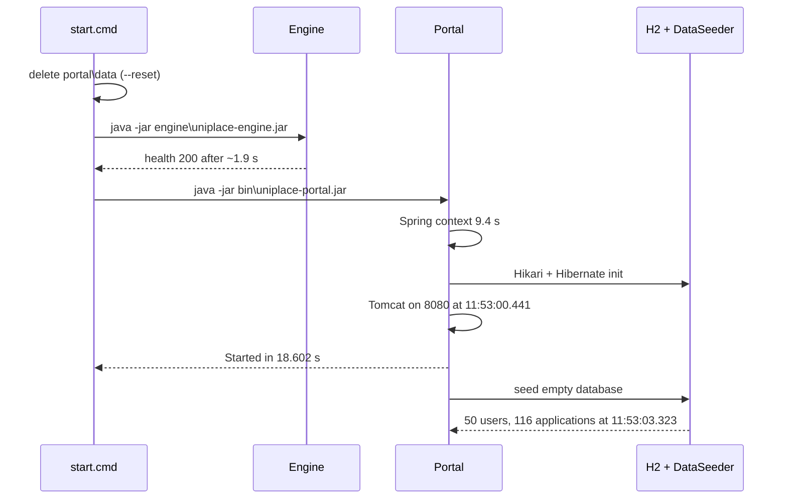

# 08 — Runtime baseline

## Purpose and environment

This file records the measured state of the delivered system: test execution, coverage, start-up timing, seed volume, authenticated probes, Engine responses, and the clean-up performed afterwards. It is the factual baseline that the hypotheses in `07-hypotheses.md` refer to.

| Item | Value | Evidence |
| --- | --- | --- |
| Date of run | 2026-11-14 (Asia/Qatar) | probe logs |
| Operating system | Windows, PowerShell | command transcripts |
| Java used at runtime | OpenJDK 21.0.9 LTS (Temurin) | `java -version`; startup log |
| Java target | 17 | `portal/pom.xml:21` |
| Build | Maven wrapper, Spring Boot 3.3.5 | `portal/pom.xml:9`; `logs/baseline-startup.log` |
| Portal mode | Prebuilt `bin/uniplace-portal.jar` | `start.cmd --jar --reset` |
| Portal address | `127.0.0.1:8080` | `application.properties:2-3` |
| Engine address | `127.0.0.1:8081/api/v1` | `application.properties:27` |
| Database | `portal/data/uniplace.mv.db` | `application.properties:6` |
| Logs | `logs/baseline-startup.log`, `logs/engine.log` | start scripts |

The runtime uses Java 21 although the build targets Java 17; no Java-21-only API is used in the reviewed source. **[INFERRED]** from the build succeeding and the application starting.

## Reproduction sequence

1. Back up `portal/data/uniplace.mv.db` to a private temporary folder.
2. Run `.\start.cmd --jar --reset` from the repository root.
3. Wait for both ports to answer, then run authenticated HTTP probes.
4. Run direct Engine probes against `http://127.0.0.1:8081/api/v1`.
5. Stop both processes; verify ports 8080 and 8081 are closed.
6. Restore the original database file and verify its size and timestamp.

This sequence is read-only with respect to `portal/` source; the only writes are runtime data and logs, both Git-ignored (`.gitignore:3-6`).

## Test execution

Command, run in `portal/`:

```powershell
.\mvnw.cmd -B test "-Dmaven.test.failure.ignore=true"
```

| Metric | Result |
| --- | --- |
| Test classes | 24 |
| Tests executed | 147 |
| Failures | 0 |
| Errors | 0 |
| Skipped | 0 |
| Aggregate reported test time | 66.319 s |
| Maven result | **BUILD SUCCESS** |
| Reports | `portal/target/surefire-reports/` |
| Coverage | `portal/target/site/jacoco/` |

The failure-ignore flag is deliberate: JaCoCo's `report` goal is bound to the `test` phase (`portal/pom.xml:95-101`), so the report is still written even if a test fails. CI restores the failure status with an XML grep (`.github/workflows/tests.yml:27-32`).

### Tests by class

| Class | Tests | Seconds |
| --- | --- | --- |
| `ai.AiClientTest` | 6 | 18.14 |
| `ai.AiResponseParserTest` | 4 | 0.07 |
| `ai.FeedbackCacheTest` | 2 | 0.04 |
| `ai.SimulatedProviderTest` | 3 | 0.03 |
| `domain.ApplicationStateMachineTest` | 25 | 0.56 |
| `domain.StandingTest` | 5 | 0.04 |
| `engine.EngineClientTest` | 5 | 0.97 |
| `engine.EngineRequestMapperTest` | 3 | 0.03 |
| `engine.MatchScoreServiceTest` | 1 | 0.34 |
| `service.ApplicationServiceTest` | 15 | 36.58 |
| `service.CompanyServiceTest` | 9 | 1.93 |
| `service.DocumentServiceTest` | 6 | 0.19 |
| `service.InterviewServiceTest` | 5 | 0.32 |
| `service.NotificationServiceTest` | 3 | 0.18 |
| `service.OfferServiceTest` | 6 | 0.32 |
| `service.PostingServiceTest` | 14 | 0.33 |
| `service.RankingServiceTest` | 2 | 0.06 |
| `service.ReportServiceTest` | 2 | 0.04 |
| `service.SettingsServiceTest` | 3 | 0.06 |
| `service.StudentServiceTest` | 5 | 0.10 |
| `service.TestDataServiceTest` | 3 | 0.11 |
| `service.UserServiceTest` | 11 | 1.43 |
| `web.FmtTest` | 3 | 0.01 |
| `web.SecurityTest` | 6 | 4.42 |

`ApplicationServiceTest` accounts for more than half the aggregate time because it starts a full Spring context and exercises several transactional flows. `AiClientTest` is the next slowest, dominated by HTTP timeouts against a mock provider. **[INFERRED]** from the per-class times.

## Coverage baseline

Totals from `portal/target/site/jacoco/jacoco.csv`:

| Metric | Covered / total | Percentage |
| --- | --- | --- |
| Lines | 1,478 / 2,591 | **57.0%** |
| Branches | 357 / 851 | **42.0%** |

### Coverage by package

| Package | Lines | Line % | Branches | Branch % |
| --- | --- | --- | --- | --- |
| `com.halcyon.uniplace.ai` | 183 / 231 | 79.2% | 61 / 106 | 57.5% |
| `com.halcyon.uniplace.config` | 34 / 298 | 11.4% | 3 / 58 | 5.2% |
| `com.halcyon.uniplace.domain` | 229 / 276 | 83.0% | 3 / 4 | 75.0% |
| `com.halcyon.uniplace.engine` | 129 / 145 | 89.0% | 8 / 10 | 80.0% |
| `com.halcyon.uniplace.security` | 40 / 46 | 87.0% | 5 / 16 | 31.2% |
| `com.halcyon.uniplace.service` | 752 / 1,038 | 72.4% | 270 / 511 | 52.8% |
| `com.halcyon.uniplace.web` | 110 / 554 | 19.9% | 7 / 146 | 4.8% |
| Root package | 1 / 3 | 33.3% | 0 / 0 | — |

### Classes worth calling out

| Class | Lines covered | Why it matters |
| --- | --- | --- |
| `config.DataSeeder` | 0 / 264 | The entire demonstration scenario is untested. |
| `web.CoordinatorController` | 13 / 99 | Admin routing is nearly untested. |
| `web.PostingController` | 11 / 94 | Recruiter posting flows, including the unguarded update, are untested. |
| `web.ApplicationController` | 11 / 119 | Application detail and all lifecycle actions are barely covered. |
| `web.StudentController` | 8 / 43 | Profile, upload, and download paths are barely covered. |
| `web.HomeController` | 13 / 43 | Login, dashboard, and error pages are barely covered. |
| `web.SettingsController` | 32 / 95 | Settings masking, CSRF exemption, and logging are partly covered. |
| `config.SecurityConfig` | 32 / 32 | Configuration itself is covered, but not its runtime consequences. |
| `service.ReportService` | 36 / 67 | Report calculations and CSV escaping are partly covered. |
| `service.ApplicationService` | 84 / 124 | Core lifecycle is reasonably covered; limit and eligibility branches are not. |
| `service.OfferService` | 86 / 150 | Offer and allowance paths are only partly covered. |
| `service.PostingService` | 87 / 123 | Search and update branches are partly covered. |

The low `web` figure is structural: `@SpringBootTest` controller tests use `MockMvc` but touch only a fraction of the route and branch matrix. The low `config` figure is almost entirely `DataSeeder` plus unexercised error configuration. Direct references: `portal/target/site/jacoco/jacoco.csv`; test sources under `portal/src/test/java/`.

## Start-up baseline



| Milestone | Timestamp / duration | Evidence |
| --- | --- | --- |
| JVM start | 11:52:42.785 | `logs/baseline-startup.log` |
| Engine ready | ~1.9 s after launch | start-script wait and `logs/engine.log` |
| Web context initialised | 9,404 ms | startup log |
| Tomcat listening on 8080 | 11:53:00.441 | startup log |
| Application started | 18.602 s (process 19.614 s) | startup log |
| Seed start | 11:53:00.548 | startup log |
| Seed complete | 11:53:03.323 | startup log |
| Total to usable demo data | ~20.5 s | derived from the timestamps |

The Engine log contains a single line: `UniPlace Matching & Compliance Engine 1.0.0 listening on 127.0.0.1:8081` (`logs/engine.log:1`).

## Seeded data observed at runtime

| Table | Rows | How observed |
| --- | --- | --- |
| Users | 50 | `/coordinator/users` (51 `tr` rows including header); role cells: coordinator 1, recruiter 8, student 41 |
| Students | 41 | `/coordinator/students` (42 `tr` rows including header) |
| Companies | 6 | `/coordinator/companies` (7 `tr` rows including header) |
| Postings | 14 | `/coordinator/postings`; seeder source |
| Applications | 116 | seed log; `/coordinator/applications` paged |
| Notifications | 118 | `/coordinator/outbox` |
| Audit entries | 1 | `/coordinator/audit` (2 `tr` rows including header) |
| Offers | 5 (2 accepted) | `/coordinator/reports/offers.csv` |
| Documents | 81 | 41 transcripts + 40 CVs; document rows 1–4 probed |

Student `student.amal`'s dashboard showed `Academic standing Good`, `Active applications 4 of 5`, `GPA 3.40`, and one offer awaiting an answer (`portal-probe-results-2.txt:4`). This is consistent with the seeded four applications, one of which is `WITHDRAWN` (`DataSeeder.java:222-225`).

## Portal HTTP probes

All probes used a real form login with CSRF and a session cookie. No credentials are reproduced here.

| Probe | Result | Interpretation |
| --- | --- | --- |
| Anonymous `/dashboard`, `/h2-console/login.jsp`, `/actuator/health`, `/no-such-page`, `/api/...` | 302 to `/login` | Security catches everything before routing |
| Anonymous `/login` | 200 | Login page reachable |
| Coordinator `/dashboard`, `/students`, `/companies`, `/users`, `/applications`, `/audit`, `/outbox`, `/reports`, `/settings`, `/tools` | 200 | Coordinator surface works |
| Coordinator `/applications/mine` | 302 to `/coordinator/applications` | Role-specific redirect |
| Student `/student/**`, `/applications`, `/notifications`, `/postings` | 200 | Student surface works |
| Student `GET /coordinator/students`, `/coordinator/users` | 403 | Role rule enforced |
| Recruiter `/recruiter/**`, `/applications`, `/postings` | 200 | Recruiter surface works |
| Recruiter `GET /coordinator/**` | 403 | Role rule enforced |
| Pending recruiter `/recruiter/company`, `/recruiter/postings` | 200 | Pending company can still use the recruiter area |
| Recruiter without company `/recruiter/company`, `/recruiter/postings` | 200 | Empty-state pages render |
| Coordinator `/coordinator/postings/999999`, `/applications/999999` | 404 | `NotFoundException` mapping works |
| Coordinator `GET /h2-console/login.jsp` | 404 | H2 console disabled |
| Coordinator `POST /coordinator/settings` without `_csrf` | 302 to settings | CSRF exemption confirmed |
| Coordinator report links | `placement.csv`, `scores.csv`, `offers.csv`, `days.csv` | Four export names are exposed |
| Legacy names `application.csv`, `offer.csv`, `company.csv`, `student.csv` | 404 | Only the four switch names work |

### Document access probe

| Document | Coordinator | Recruiter | Pending recruiter | Owning student | Other student |
| --- | --- | --- | --- | --- | --- |
| 1 (Amal CV) | 200 PDF | 200 PDF | 200 PDF | 200 PDF | — |
| 2 (Amal transcript) | 200 PDF | 200 PDF | 200 PDF | 200 PDF | — |
| 3 (Omar CV) | 200 PDF | 200 PDF | 200 PDF | — | 403 |
| 4 (Omar transcript) | 200 PDF | 200 PDF | 200 PDF | — | 403 |

The pending recruiter belongs to a company whose status is `PENDING`, and the recruiter without a company was not needed for the decisive case. The owning student received 403 for documents 3–4, proving the check distinguishes students but not recruiters (`portal-probe-results-2.txt:17-32`; `StudentController.java:99-105`).

## Reports observed at runtime

| Report | Value |
| --- | --- |
| Placement, Mechanical Engineering | 10 students, 0 placed, 0.0% |
| Placement, Business Management | 8 students, 0 placed, 0.0% |
| Placement, Data Science | 8 students, 1 placed, 12.5% |
| Placement, Information Systems | 8 students, 0 placed, 0.0% |
| Placement, Software Engineering | 7 students, 1 placed, 14.3% |
| Average score, QTech | 19.3 across 23 applications |
| Average score, Gulf Bank | 29.1 across 32 applications |
| Average score, Doha Energy | 30.9 across 22 applications |
| Average score, Lusail Health | 30.0 across 17 applications |
| Average score, Pearl Logistics | 24.5 across 22 applications |
| Offers issued / accepted | 5 / 2, 40.0% |
| Average days from submission to offer | 12.6 across 5 offers |

The averages are low because the Engine's match scores in this scenario cluster below the 60 shortlist threshold. Desert Bloom has no applications, so it has no row in the score table. Evidence: `/coordinator/reports` HTML captured at `portal-probe-results-2.txt:5-10`; `report-offers.csv`; `ReportService.java:42-93`.

## Engine probes

Base URL `http://127.0.0.1:8081/api/v1`; every request was well-formed JSON unless stated. All responses below are from the delivered JAR, never from decompilation.

| Endpoint | Valid request | Boundary / invalid observations |
| --- | --- | --- |
| `GET /health` | 200 `{"status":"UP","version":"1.0.0"}` | Unknown path 404; wrong method 405 |
| `POST /eligibility` | 200 with `eligible` and `reasons` | Missing required fields → **500**; `gpa:9` and `standing:"BAD"` accepted; transcript 180 days rejected, 179 accepted |
| `POST /match` | 200 with score and matched/missing lists | Empty required skills 400; case/space changes lower the score; omitted `niceToHaveSkills` yields a higher score |
| `POST /rank` | 200 with `ranked` and `aboveCut` | 0 seats 400; 501 candidates 400; 1000 seats 400; equal-score order ignores GPA |
| `POST /schedule/validate` | 200 with `valid` and `conflicts` | Exactly 120 minutes rejected; 119 accepted; end 18:01/18:59 accepted; adjacent slot flagged overlapping; Friday rejected |
| `POST /allowance` | 200 with `total` and `lines` | 30 hours → no transport, 31 hours → transport; cap 5000 with 5000 allowance → 5300 total |

### Request/response shape checks

| Check | Observed | Contract expectation |
| --- | --- | --- |
| Validation envelope | `{"error":"validation","field":...,"message":...}` for most 400s | Same (`openapi.yaml:130-140`) |
| Missing body fields | 500 `{"error":"internal","message":"Unexpected error"}` | 400 validation |
| Unknown path | 404 `{"error":"not_found",...}` | Not specified, reasonable |
| Wrong method | 405 `{"error":"method_not_allowed",...}` | Not specified, reasonable |
| Non-JSON body | 400 `field:"body"` `"Malformed JSON"` | 400 |
| Date-time without offset | Accepted as UTC | Contract says UTC when offset absent (`openapi.yaml:5-9`) |
| Duplicate document types | Accepted | Not specified |
| Unknown document type | 400 `must be one of CV, TRANSCRIPT` | Enum enforced |

### Eligibility boundary matrix

| Input | Result |
| --- | --- |
| GPA 9 | `eligible:true` |
| GPA −1 | `eligible:false`, "below the minimum 2.0" |
| Standing `BAD` | `eligible:true` |
| Standing `good` | `eligible:true` |
| Credits 200 | 400, "must be between 0 and 140" |
| Prior internships −1 | 400, "must be between 0 and 100" |
| Probation + 2 internships | `eligible:false` |
| Probation + 1 internship | `eligible:true` |
| Transcript issued 2026-05-19 (179 days) | `eligible:true` |
| Transcript issued 2026-05-18 (180 days) | `eligible:false` |
| Transcript issued in the future | `eligible:false` |
| CV exactly 2 MB | `eligible:true` |
| CV 2 MB + 1 byte | `eligible:false` |
| CV as DOCX | `eligible:false` |
| No documents | `eligible:false`, both missing |

## Clean-up and restoration

| Action | Result |
| --- | --- |
| Portal and Engine stopped | Ports 8080 and 8081 no longer listening |
| Database restored from backup | `portal/data/uniplace.mv.db`, 253,952 bytes, timestamp 2026-11-14 11:03:38 |
| Repository state | Only `docs/reverse-engineering/` is untracked; `portal/` is unchanged |
| Runtime artefacts | Logs and probe captures remain under `logs/` and the temporary probe folder |

Verification after clean-up: `git status --short` shows only `?? docs/reverse-engineering/`; `Get-NetTCPConnection` returns nothing for 8080/8081.

## Limitations of this baseline

| Limitation | Effect |
| --- | --- |
| One machine, one run | Timings are indicative, not statistically stable. |
| Prebuilt JAR, not source build | Runtime matches `bin/uniplace-portal.jar`, whose commit is not recorded. |
| Java 21 runtime, Java 17 target | A Java-17-only deployment may differ slightly in start-up time. |
| Seeded data is date-relative | Counts and boundary cases shift if the database is recreated on another day. |
| No load or concurrency testing | The seat-race and N+1 hypotheses are reasoned, not stress-tested. |
| No real SMTP or AI provider | Mail and AI failure paths were not exercised against live services. |
| No browser automation | JavaScript behaviour (for example the letter counter) is source-read only. |
| Black-box Engine | Only HTTP behaviour is known; internal rules remain **[UNKNOWN]**. |

## Open questions

- Is the 18–20 second Portal start-up acceptable, and which part is expected to dominate on the customer's hardware?
- Are the measured coverage figures the team's baseline, or is a higher threshold expected before release?
- Should the 116-application seed volume be larger for performance testing, and is `TestDataService` used for that?
- Are the runtime report values (40.0% acceptance, 12.6 average days) plausible reference outputs for regression tests?
- Which Engine deviations are stable enough to encode as contract tests, and which are defects to report upstream?
- Should the baseline be repeated on Java 17 with a source build to remove the JAR/version ambiguity?
- Is the restored database the correct hand-over state, or should the evaluator start from `--reset`?
