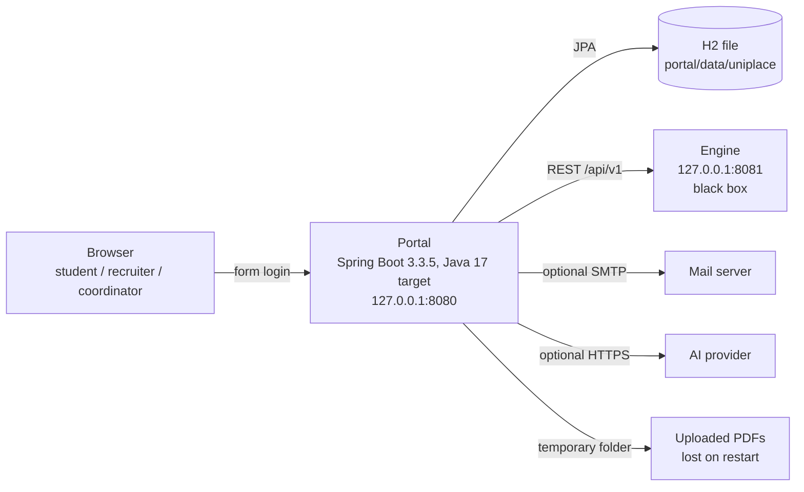

# 09 — Summary

## What was delivered

A read-only reverse-engineering of UniPlace: Portal source, templates, tests, build, and configuration were read; the prebuilt Engine was treated as a black box; the delivered system was started, seeded, probed through authenticated sessions, and shut down. No Portal file was modified, no Engine class was decompiled, and no secret was reproduced. Suspicious behaviour is recorded as hypotheses, not defects.

Companion documents `00`–`08` cover inventory, architecture, domain, rules, HTTP and Engine API, security, configuration, hypotheses, and runtime evidence.

## The system in one view

The Portal is a server-rendered Thymeleaf application with Spring Security form login, three roles, JPA/H2 persistence, and six Engine calls: health, eligibility, match, rank, schedule validation, and allowance.

## Test and coverage baseline

| Metric | Result |
| --- | --- |
| Tests | **147 passed**, 0 failed, 0 errors, 0 skipped |
| Test classes | 24 |
| Build | Maven `BUILD SUCCESS` |
| Line coverage | **57.0%** (1,478 / 2,591) |
| Branch coverage | **42.0%** (357 / 851) |
| Lowest package | `web` 19.9% lines / 4.8% branches, `config` 11.4% |
| Untested area | `DataSeeder` 0 / 264 lines |

The suite is green but concentrated in services and domain state machines. The controllers that enforce access, the seeder that defines the demo scenario, and the Engine integration stubs are thin or absent. Two tests lock in questionable behaviour: an Engine validation error is asserted as "unavailable", and the match-score test cannot detect the cache-key defect.

## Runtime baseline

The Engine answered health in about 1.9 seconds. The Portal started in 18.6 seconds and finished seeding 0.8 seconds later: 50 users, 41 students, 6 companies, 14 postings, 116 applications, 5 offers (2 accepted), 118 notifications, and 1 audit entry.

Runtime reports produced 40.0% offer acceptance, 12.6 average days to offer, and placement rates of 12.5% (Data Science) and 14.3% (Software Engineering), the other programs at 0%. Average match scores ranged from 19.3 to 30.9, below the 60 shortlist threshold.

Role probes behaved as designed at the URL level: anonymous requests redirected to login, students and recruiters received 403 on coordinator routes, and missing records returned 404. H2 console was absent. The database was restored and both ports were closed afterwards.

## Highest-confidence findings

| Theme | Finding | Evidence |
| --- | --- | --- |
| Access control | Any recruiter, including a pending or company-less one, can download any student document | `StudentController.java:99-105`; runtime 200 for documents 1–4 |
| Access control | Application detail has no ownership guard | `ApplicationController.java:97-104` |
| Access control | Posting update has no ownership guard | `PostingController.java:160-171` |
| Access control | Settings POSTs are CSRF-exempt | `SecurityConfig.java:25`; runtime 302 without token |
| Access control | Company name is rendered with `th:utext` | `postings/list.html:29` |
| Eligibility | The Portal sends the global default minimum GPA, not the posting's | `EngineRequestMapper.java:43` |
| Eligibility | `priorInternships` is never sent | `EngineRequestMapper.java:37-55` |
| Resilience | Eligibility fails open; match score fails to zero | `EngineClient.java:87-102` |
| Correctness | Match-score cache key ignores student skills | `MatchScoreService.java:44-51` |
| Correctness | Active limit counts withdrawn applications | `ApplicationService.java:89-92` |
| Correctness | Deadline-day applications are refused | `PostingService.java:51-55` |
| Correctness | Offer response deadline is truncated to midnight | `OfferService.java:81-83` |
| Storage | Uploads go to a fresh temp folder on every start | `DocumentService.java:43-48`, `:109-116` |
| Settings | Three limits are cached in static fields forever | `SettingsService.java:101-124` |

The Engine also deviates from its own contract: missing required fields return 500 instead of 400; GPA above 4 and arbitrary standing strings are accepted; undocumented bounds exist; transcript validity is 179 days rather than 180; match is case/space sensitive; rank ignores the GPA tie-break; 120-minute slots are rejected while 18:59 ends are accepted; and the allowance rule drops transport at exactly 30 hours and ignores a cap adjustment.

## What this means for testing

Priority should go to the access-control gaps, eligibility request mapping, fail-open paths, the score cache, and offer/deadline boundaries. These affect confidentiality and money, and most sit in code with low coverage. Engine contract tests should pin the 400/500 distinction, enum and range validation, and the boundary cases above, using the real Engine or contract-derived stubs rather than only `@MockBean` replacements.

## Confidence and limits

Everything labelled **Confirmed** was reproduced against the delivered JARs on 2026-11-14. Source-evident findings are unambiguous paths but were not exploited. Engine internals remain **[UNKNOWN]**; only HTTP behaviour is known. Timings come from one Windows run on Java 21, and seeded data is date-relative, so numbers will shift. No load, browser, live-SMTP, or live-AI testing was performed.

## Open questions

- Which access-control findings are intended recruiting behaviour and which are defects?
- Is fail-open eligibility an accepted availability trade-off, and who owns that risk?
- Should the Portal or the Engine own posting-specific eligibility policy?
- Are the Engine deviations defects, or is the contract out of date?
- Which findings should become the first automated regression tests?
