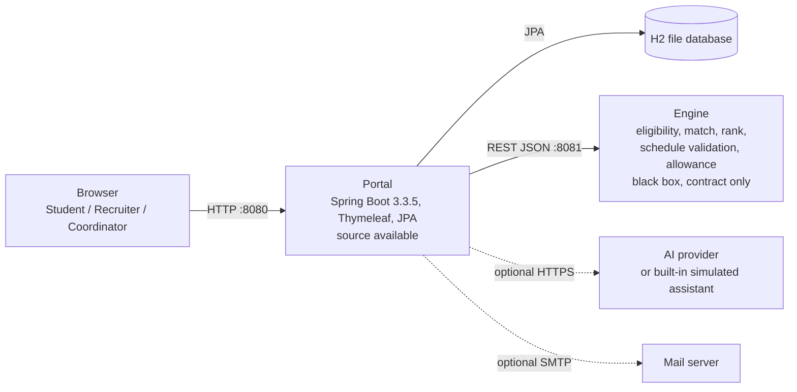

# UniPlace Acceptance Test Strategy

| | |
|---|---|
| **Document** | `docs/test-strategy.md` |
| **Version** | 1.0 (baseline) |
| **Date** | 14 Nov 2026 |
| **Status** | Living document. Every change is recorded in the change log (section 18). |
| **Owner** | QA team |
| **Related documents** | `docs/test-plan.md` (work breakdown and schedule), `docs/test-cases.md`, `docs/ai-usage-log.md`, `tests/README.md`, `docs/reverse-engineering/` (system analysis, 00 to 09) |

## Document map

| Topic | Where |
|---|---|
| Risks and scope | Section 5 (scope), 6.1 and 6.2 (module importance), 7 (risk assessment) |
| Primary modules (three) and why | Section 6.3 |
| Test levels, techniques and tools, and why | Section 8 |
| Team organisation and Git workflow | Section 12 |
| Changes along the way (date, what changed, why) | Section 18 |

---

## 1. Purpose and context

The QA team has been engaged to carry out independent acceptance testing of **UniPlace**, an internship and placement portal delivered by a vendor. The number, nature and severity of the defects in the delivered system are unknown.

This strategy defines how the team will find as many defects as possible, starting where they would hurt most, and how findings will be evidenced, classified, explained and reported. It covers risks, scope, test levels, techniques, tools, roles, the Git workflow, defect management, environments, and the criteria for starting and stopping testing.

## 2. System under test



| Component | Role | Visibility |
|---|---|---|
| **Portal** | Server-rendered web application: three roles (Student, Recruiter, Coordinator), business rules, state machines, persistence, access control, notifications, reports, AI integration | Source code, tests and configuration available (white-box) |
| **Engine** | Stateless calculation service with six endpoints under `/api/v1`: `/health`, `/eligibility`, `/match`, `/rank`, `/schedule/validate`, `/allowance` | Prebuilt jar and `engine/openapi.yaml` only (black-box) |
| **AI Assistant** | Motivation-letter feedback and interview-question generation, through an OpenAI-compatible provider or a simulated fallback | Portal code and provider traffic observable |

**Measured baseline** (reverse-engineering run, 14 Nov 2026):

| Measure | Value |
|---|---|
| Portal main sources | 89 Java files, 26 templates, 3 scripts |
| Vendor test suite | 147 tests in 24 classes, all passing |
| Line / branch coverage (all) | 57.0% / 42.0% |
| Service layer line / branch coverage | 72.4% / 52.8% |
| Web layer line / branch coverage | 19.9% / 4.8% |
| Seed data | 50 users, 41 students, 6 companies, 14 postings, 116 applications, 5 offers |
| Engine probes vs. contract | 60 probes, 18 deviations (9 clusters) |

## 3. Objectives and quality goals

| ID | Objective |
|---|---|
| O1 | Expose the highest-impact defects first: exposure or tampering with data, wrong eligibility or money decisions, loss of data. |
| O2 | Verify conformance to the Requirements, functional and non-functional, with traceable evidence. |
| O3 | Verify the Engine independently against its published contract. |
| O4 | Verify integration behaviour between Portal and Engine, including failure handling. |
| O5 | Identify specification defects (contradictions, ambiguities, gaps, untestable statements) early. |
| O6 | Leave behind automated tests that reproduce every confirmed defect and run from the repository. |
| O7 | Explain defects by root cause and recommend fixes for the product and for the vendor's process. |

## 4. Test basis and oracles

| Priority | Source | Use |
|---|---|---|
| 1 | **Requirements** (`Project-Requirements`, IDs USR, STU, COM, POS, APP, INT, OFF, NOT, AI, ADM, PERF, SEC, REL, USA, COMP, MAINT) | Primary oracle. Behaviour that contradicts it is a defect. Behaviour it does not mention is raised as a clarification and may be a specification defect. |
| 2 | **`engine/openapi.yaml`** | Authoritative contract for the Engine. |
| 3 | Domain reasoning | Only where 1 and 2 are silent, and only to raise a clarification. |

Not oracles: vendor tests, code comments and observed behaviour. Two vendor tests assert behaviour that conflicts with the contract, so expected results are always written from the requirement, never copied from the current output.

## 5. Scope

**In scope**
- Portal functions of all three roles, with formal test design for the three primary modules (section 6.3).
- Engine contract conformance for all six endpoints.
- Portal-to-Engine integration, including failure and degradation behaviour.
- AI Assistant behaviour, privacy and robustness.
- Performance, security, reliability and usability checks against the non-functional requirements.
- Review of the specification and of the vendor's automated tests and CI.

**Out of scope**
- Delivery of e-mail through a real SMTP server.
- Production deployment, hardware, backup and operating-system hardening.
- Internals of the Engine (no decompilation or binary inspection).
- Exhaustive cross-platform execution. Compatibility is sampled on the team's machines with the latest Chrome and Firefox.
- Penetration testing beyond application-level checks.

## 6. Module prioritisation

### 6.1 Method

Every functional or cross-cutting module of the system is scored on **Impact** (1 to 5: what a failure causes) and **Likelihood** (1 to 5: probability of defects, from the reverse-engineering evidence, complexity and coverage gaps). **Score = Impact × Likelihood.** Tiers: **Critical ≥ 20**, **High 12 to 19**, **Medium 6 to 11**, **Low ≤ 5**.

### 6.2 Module inventory and importance

| # | Module | Requirements | I | L | Score | Importance | Basis |
|---|---|---|---|---|---|---|---|
| 1 | Access Control and Security | USR-01 to 05, SEC-01 to 07 | 5 | 5 | 25 | **Critical** | Confirmed cross-user document access (H-01); no ownership guard on application view and posting update (H-02, H-03); CSRF exemption (H-04); logout leaves session valid (H-05); stored-XSS sink (H-06); secrets in logs and stack traces enabled (H-07, H-08). Web layer branch coverage 4.8%. |
| 2 | Engine Integration, Eligibility, Matching and Ranking | APP-04, APP-07, APP-09, REL-01, REL-02 | 5 | 5 | 25 | **Critical** | Wrong minimum GPA sent (H-20); `priorInternships` never sent (H-21); eligibility and match fail open (H-22, H-23); score cache ignores student skills (H-24); Engine 500 on missing fields (H-28); 18 of 60 probes deviate from contract. |
| 3 | Application Lifecycle | APP-01 to 10 | 4 | 5 | 20 | **Critical** | Active limit counts withdrawn applications (H-11); deadline day refused (H-12); threshold boundary (H-18); ranking refused above 500 candidates (H-19); no database uniqueness for double submission (APP-05). |
| 4 | Offers and Allowance | OFF-01 to 07 | 5 | 4 | 20 | **Critical** | Non-atomic seat check (H-14); response deadline truncated to midnight (H-13); transport and cap boundaries differ from contract (H-36); allowance statement silently null when Engine is down. |
| 5 | Data Persistence and File Storage | REL-04, STU-04 | 5 | 4 | 20 | **Critical** | Uploads land in a new temporary folder on every start (H-41); no uniqueness constraints for offers, documents or user-student links; schema managed by `ddl-auto=update`. |
| 6 | Student Profile and Documents | STU-01 to 04 | 4 | 4 | 16 | **High** | Standing not recomputed after GPA change (H-15); document exposure (H-01); upload validation is the main untrusted-input entry. |
| 7 | AI Assistant | AI-01 to 11, REL-03 | 3 | 5 | 15 | **High** | PII and unescaped letter sent to provider (H-09); cache ignores letter (H-37); item counts unenforced (H-38); prompt hard-codes pay and duration (H-40). |
| 8 | Interview Scheduling | INT-01 to 05 | 3 | 4 | 12 | **High** | Engine rejects 120-minute slots, accepts ends after 18:00, treats adjacent slots as overlap (H-35). |
| 9 | Posting Management | POS-01 to 07 | 3 | 4 | 12 | **High** | Any recruiter can edit any posting (H-03); deadline boundary (H-12). |
| 10 | Administration | ADM-01 to 05 | 3 | 4 | 12 | **High** | Three settings cached indefinitely (H-42); same-second audit entries dropped (H-17); report N+1 queries, diluted average and CSV formula injection (H-43 to 45). |
| 11 | Company Management | COM-01 to 03 | 3 | 3 | 9 | **Medium** | Uniqueness may be case-sensitive; suspension freeze behaviour unclear. |
| 12 | Notifications and Outbox | NOT-01 to 05 | 2 | 4 | 8 | **Medium** | Mail failure rolls back the business action (H-16); reminder flag never persisted; spec conflict between NOT-04 and OFF-02. |
| 13 | Background Jobs | OFF-02, NOT-04, POS-03 | 3 | 3 | 9 | **Medium** | Ten-minute scheduler, single instance; reminders may repeat. |
| 14 | Performance and Scalability | PERF-01 to 05 | 3 | 3 | 9 | **Medium** | Eager loading, N+1 reports, 500-candidate ranking limit. |
| 15 | Quality Infrastructure (vendor tests, CI, build) | MAINT-01, MAINT-02 | 2 | 4 | 8 | **Medium** | Two vendor tests assert wrong behaviour (H-48, H-49); mocks hide contract drift (H-51); CI never starts the Engine (H-50). |
| 16 | Usability and Compatibility | USA-01 to 08, COMP-01 | 2 | 3 | 6 | **Medium** | No evidence yet; sampled by exploratory sessions. |

### 6.3 Primary modules (three) and why

The three primary modules are ordered by priority. Each is a coherent group of Requirements and together they contain every Critical module of the inventory.

| Priority | Primary module | Test-case prefix | Constituent inventory modules (with importance) | Requirements in scope |
|---|---|---|---|---|
| **1** | **Users and Access Control** | `TC-USR` | Access Control and Security (**Critical**); Student Profile and Documents, document access part (**High**); Posting Management, ownership part (**High**) | USR-01 to 05; SEC-01 to 07; STU-02 to 04 (access and upload parts); POS-05 (ownership) |
| **2** | **Applications and Eligibility Decisions** | `TC-APP` | Engine Integration, Eligibility, Matching and Ranking (**Critical**); Application Lifecycle (**Critical**); Interview Scheduling (**High**, executed as an extension module, `TC-INT`) | APP-01 to 10; REL-01, REL-02; POS-02, POS-04; INT-01 to 05 (extension) |
| **3** | **Offers and Allowance** | `TC-OFF` | Offers and Allowance (**Critical**); Data Persistence and File Storage, restart and durability scenarios (**Critical**); Background Jobs, expiry and reminders (**Medium**) | OFF-01 to 07; NOT-04; REL-04; PERF-03 (concurrent acceptance) |

**Planned design depth per primary module: at least 15 test cases**, of which at least 6 black-box functional, 3 white-box, 3 non-functional and 1 gray-box.

**Why these three**

1. **Risk coverage.** Together they contain all five Critical modules of section 6.2, which hold the highest-impact failure modes: exposure of data, wrong eligibility and money decisions, and loss of data. A different selection would leave a Critical module without formal test design.
2. **Distinct mechanisms.** Each module exercises a different part of the system and a different mix of techniques: access control (no Engine; gray-box and security testing, role matrices), applications (Engine eligibility, match, rank and schedule decisions; decision tables and state transitions) and offers (Engine allowance; boundary analysis against an independent oracle, concurrency and durability).
3. **Requirement depth.** Each is a coherent group of requirements large enough to support at least 15 distinct, traceable test cases: USR and SEC (12 requirements), APP (10), OFF (7).
4. **Independence.** Each can be owned and executed by one engineer with limited hand-offs, and each yields defects the others cannot duplicate.
5. **What is not primary.** Posting, student, company, notification, AI and administration requirements still receive targeted tests or exploratory sessions (section 6.4); they were ranked below the Critical tier on impact and on the strength of the evidence.

### 6.4 Coverage of the remaining modules

| Tier | Modules | Approach |
|---|---|---|
| Targeted tests | AI Assistant, Administration, Posting Management, Student Profile and Documents (non-access parts), Performance and Scalability | Dedicated automated suites or scripted checks, with test cases recorded under their own prefixes (`TC-AI`, `TC-ADM`, `TC-POS`, `TC-STU`, `TC-NFR`) |
| Exploratory sessions | Company Management, Notifications and Outbox, Usability and Compatibility | Time-boxed charters (section 8.6) |
| Static review | Quality Infrastructure, Specification | Review of vendor tests, CI and requirements text |

## 7. Risk assessment

| ID | Risk | Impact | Likelihood | Requirements | Test response |
|---|---|---|---|---|---|
| R-01 | Users read or change data that belongs to others (documents, applications, postings, settings). | Very high | Very high | USR-05, SEC-05 | Role × route matrix (automated, parameterised); direct-URL and tampered-ID checks; session replay after logout. |
| R-02 | Eligibility decisions are wrong or skipped when the Engine is degraded. | Very high | Very high | APP-04, REL-01, REL-02 | Decision-table tests; mapper tests against the contract; failure-injection matrix (section 8.4). |
| R-03 | Match scores and rankings are wrong, distorting shortlisting. | High | Very high | APP-07, APP-09 | Independent score oracle; cache tests with differing skill sets; tie-break tests. |
| R-04 | Seats are oversold or allowances miscalculated. | Very high | High | OFF-03 to 05, OFF-07 | Concurrency tests on the last seat; allowance model oracle with worst-case combinations. |
| R-05 | Business data is lost or inconsistent after restart. | Very high | High | REL-04, STU-04 | Restart scenarios for documents, offers and applications. |
| R-06 | State machine can be bypassed through a non-UI channel. | High | High | APP-06 | All 49 state pairs at service level; sampled direct POSTs. |
| R-07 | Boundary mistakes in deadlines, windows and limits. | Medium | Very high | POS-04, OFF-02, APP-02, INT-02, INT-03 | EP/BVA tables per variable; special-value tests (deadline today, day 180, 18:00). |
| R-08 | Student personal data reaches the AI provider; the assistant is steerable by letter text. | High | High | AI-03, AI-04, AI-10 | Provider simulated by WireMock to inspect every outbound prompt; injection letters. |
| R-09 | CSRF, XSS, secret logging and error disclosure. | High | Medium | SEC-02, 03, 04, 07 | Gray-box probes; log inspection; XSS payload tests across all roles' screens. |
| R-10 | Settings do not take effect immediately; operational failures (mail, scheduler). | Medium | High | ADM-01, NOT-04, NOT-05 | Change-then-observe tests; SMTP-failure scenario; scheduler observation. |
| R-11 | Performance targets not met at volume. | Medium | Medium | PERF-01 to 03, 05 | Volume generation and k6 load, stress and percentile reporting. |
| R-12 | The specification itself is contradictory, ambiguous or incomplete. | Medium | High | multiple | Static requirements review and clarification register (section 17). |
| R-13 | Vendor tests and CI give false assurance. | Medium | High | MAINT-01 | Review of tests that assert wrong behaviour; contract tests against the running Engine. |

## 8. Test levels, techniques and tools, and why

### 8.1 Levels and automation targets

Automation follows a pyramid adapted to a defect-finding engagement: broad, cheap checks at service and contract level; a small number of realistic end-to-end checks.

| Level | Scope | View | Planned volume |
|---|---|---|---|
| Unit / service | Portal services and domain logic in isolation | White-box | about 30 tests |
| Web and security slice | Controllers, filters and role rules with MockMvc and Spring Security Test | White-box / gray-box | about 25 tests |
| Engine contract | All six endpoints against `openapi.yaml` and the Requirements | Black-box | about 60 parameterised rows |
| Integration | Portal with a real or simulated Engine, including failure injection | Gray-box | about 10 tests |
| System / end-to-end | Critical journeys (apply, shortlist, interview, offer, accept) run through the UI | Black-box | 3 to 5 journeys (optional automation) |
| Performance | List pages, concurrent browsing and applying, Engine latency | Black-box | 3 scripts |
| AI evaluation | Repeated runs against properties that must always hold | Black-box | 1 harness |

### 8.2 Techniques and where they are applied

| Technique | Applied to | Examples |
|---|---|---|
| Equivalence partitioning | Every input with a valid and an invalid class | Valid and invalid file types, roles, skill lists, document types |
| Boundary value analysis (robust, 6n+1) | Numeric, date and size inputs | GPA −0.01, 0.00, 0.01, 1.99, 2.00, 3.99, 4.00, 4.01; credits 0, 140, 141; seats 0, 1, 20, 21; hours 9, 10, 40, 41; letter 99, 100, 2000, 2001; CV 2 MB and 2 MB + 1 byte; transcript 5 MB and 5 MB + 1 byte |
| Worst-case boundary analysis | Interacting variables of the allowance formula (weekly hours × duration × late days) | 5³ = 125 combinations compared with an independent calculator written from OFF-05 |
| Decision tables | Eligibility (every failed rule must be reported), shortlist threshold with override, allowance (transport, cap, penalty) | One table per rule set; each rule combination becomes a parameterised row |
| State transition testing | Application, offer, posting, company, interview and login-lockout lifecycles | Application: 7 states give 49 ordered pairs (13 valid, 36 invalid), all at service level and sampled through direct POSTs |
| Special-value testing | Dates, files, text | Deadline today and yesterday, Friday and Sunday interviews, end at 18:00 and 18:01, transcript day 179/180/181, leap-year allowance span, HTML and formula characters in names, case and whitespace variants of company names |
| Control-flow and basis-path testing | The most complex Portal methods, selected from a complexity and CK-metrics report | Candidates: `ApplicationService.submit`, `shortlist`; `OfferService.issue`, `accept`; `InterviewService.schedule`; `PostingService.apply`. Target: at least 80% branch coverage on these methods from the team's own tests |
| Loop and list-size testing | Pagination, ranking and skill lists | 19, 20, 21, 40, 41 rows (20 per page); ranking with 0, 1, 2, 499, 500, 501 candidates; skill lists of 0, 1, 30, 31 |
| Gray-box testing | Where knowledge of structure reveals bypasses | Direct requests with another role's session or a tampered identifier; replaying a session after logout; calling endpoints without form tokens |
| Concurrency and idempotency testing | Last-seat acceptance, double submission | Parallel acceptance of two offers for one seat; repeated identical application POSTs |
| Failure-injection testing | Portal-to-Engine and Portal-to-AI dependencies | Matrix in section 8.4 |
| Static review | Requirements, vendor tests, CI | Contradictions, ambiguities, gaps, untestable statements, assertions that lock in wrong behaviour |
| Exploratory testing | Areas with little evidence | Charters in section 8.6 |

**Why these techniques.** Equivalence partitioning and boundary analysis are used where inputs have documented ranges, because defects cluster at the edges and the inventory shows several boundary errors. Decision tables are used where rules interact (eligibility, allowance), because combinations are where reasons go missing. State-transition testing is used where history matters (application, offer and login lifecycles), because bypassing a transition through another channel is a known failure pattern. Basis-path and branch-coverage analysis is applied where complexity and weak coverage coincide (service layer branches at 52.8%). Gray-box probes are used because the interface hides controls that the server must still enforce. Concurrency tests target the non-atomic checks found in the offer flow. Failure injection is used because mocks alone hide contract and protocol problems. Static review comes first because specification faults are the cheapest to find and the most expensive to leave.

### 8.3 Tools and alternatives considered

| Purpose | Selected | Reason | Alternatives considered |
|---|---|---|---|
| Unit, service and slice tests | JUnit 5, Mockito, Spring Boot Test, MockMvc, Spring Security Test | Already in the Portal build; no new dependencies | None needed |
| Coverage | JaCoCo (already configured) | Line and branch coverage by class | None needed |
| Complexity and CK metrics | PMD or Lizard for cyclomatic complexity; a CK-metrics tool (WMC, CBO, DIT, NOC) | Evidence for choosing white-box targets | Manual counting (slow, error-prone) |
| Engine contract tests | JUnit 5 `@ParameterizedTest` with Java `HttpClient` and Jackson, in a standalone module under `tests/engine-contract` | Boundary tables map directly to parameter rows; same toolchain as the Portal; one command | pytest (extra runtime); Postman/Newman (weak parameterisation, needs Node) |
| Failure injection and provider simulation | WireMock 3.9.1 (already a test dependency) plus stopping the real Engine jar | Deterministic faults and prompt inspection at no quota cost | Mock beans only (hides contract drift) |
| Performance | k6 | Percentile thresholds map directly to the PERF requirements; single binary | JMeter (GUI/XML scripts); Locust (extra runtime) |
| UI journeys | Playwright (optional) | Reliable browser automation if time allows | Selenium (heavier setup); manual scripted runs |
| Security probes | Browser developer tools, scripted requests; OWASP ZAP baseline scan (optional) | Direct, repeatable gray-box checks | Full penetration tooling (out of scope) |
| Test-suite strength (optional) | PIT mutation testing on selected services | Detects tests with weak oracles | None |

### 8.4 Failure-injection matrix (REL-01, REL-02, REL-03)

Each condition is applied to each Engine-dependent operation. The expected outcome is the same everywhere: **the operation is refused with a clear message, no state changes, and no default (eligible, valid slot, computed allowance) is assumed.**

| Condition | Submit application | Rank candidates | Schedule interview | Accept offer (allowance) | Recalculate allowance |
|---|---|---|---|---|---|
| Engine stopped | | | | | |
| Response slower than the 10 s client timeout | | | | | |
| HTTP 400 validation response | | | | | |
| HTTP 500 response | | | | | |
| Malformed or empty body | | | | | |

The same approach is used for the AI provider (timeout, error, invalid structure), where the expected outcome is "Assistant unavailable" and no blocking of the business operation (AI-05, AI-06, REL-03).

### 8.5 Non-functional testing

| Area | Method | Targets |
|---|---|---|
| Performance | Seed data plus 1,000 generated applications for list pages (p95 ≤ 2 s); 50 concurrent users for 5 minutes (no errors, none above 3 s); Engine latency (p95 ≤ 200 ms eligibility and match, ≤ 500 ms for ranking 200 candidates); unbounded-list inspection | PERF-01 to 03, 05. Percentiles (p95, p99) are reported, not averages. Stress to the breaking point and recovery check. |
| Security | Automated role × route matrix; direct-request and tampering checks; XSS payloads in every free-text field across all roles' screens; CSRF without token on every data-changing form; error-page and log inspection with canary secrets; upload validation with oversized, renamed and non-PDF files | SEC-01 to 07, USR-03 to 05 |
| Reliability | Failure-injection matrix; restart scenarios; concurrency | REL-01 to 04 |
| AI quality | Letters in `ai-eval/` run repeatedly; properties: score 0 to 100; 1 to 5 strengths, gaps and improvements; valid structure; identical result within the 10-minute cache window; score spread ≤ 10 outside it; no personal data in the request; injection letters scored on content only | AI-01 to 11 |
| Usability and compatibility | Charters; formatting, confirmation, form retention, filter retention and keyboard checks; key journeys on the latest Chrome and Firefox | USA-01 to 08, COMP-01 |

### 8.6 Exploratory charters (60 to 90 minutes each)

| Charter | Focus |
|---|---|
| X-01 | Company registration, approval, suspension and the effect on postings and applications (COM-01 to 03) |
| X-02 | Notification content, visibility per role and secrecy (NOT-01 to 03, NOT-05) |
| X-03 | Usability sweep per role: formats, confirmations, retained input, labels, keyboard use (USA-01 to 08) |
| X-04 | Compatibility of key journeys on Chrome and Firefox (COMP-01) |
| X-05 | Posting search, sorting, pagination and filter retention (POS-06, APP-10, USA-07) |
| X-06 | Dashboard and report figures against recomputed values; CSV export content (ADM-02, ADM-04) |

Each session records the charter, the tester, the date, the environment, notes, and any defects raised.

### 8.7 Automation architecture and commands

```
tests/
  README.md              exact commands and prerequisites
  run-all.sh / run-all.cmd   one command that runs every suite below
  engine-contract/       JUnit 5 black-box tests for the six Engine endpoints
  integration/           Portal-to-Engine failure-injection tests (WireMock and real jar)
  performance/           k6 scripts and result summaries
  ai-evaluation/         harness, input letters, run results
  security/              scripted gray-box probes
portal/src/test/java/    additional white-box tests, next to the vendor tests
```

| Suite | Command (documented in `tests/README.md`) | Needs |
|---|---|---|
| Portal white-box | `./mvnw -f portal/pom.xml test` | JDK 17 or 21 |
| Engine contract | `mvn -f tests/engine-contract/pom.xml test` | Engine running on 8081 |
| Integration | `mvn -f tests/integration/pom.xml test` | Engine jar for the real-jar cases |
| Performance | `k6 run tests/performance/<script>.js` | k6, Portal and Engine running |
| AI evaluation | per `tests/ai-evaluation/README` | Provider key or WireMock mode |

Every automated test cites its test-case ID in its name or documentation, and every confirmed defect gets a regression test where one can be written.

## 9. Test case design standard

**ID format:** `TC-<PREFIX>-<nnn>`, for example `TC-APP-001`. Prefixes: `USR`, `APP`, `OFF` (primary modules); `INT`, `STU`, `POS`, `COM`, `NOT`, `AI`, `ADM`, `NFR` (other modules).

**Record format** (in `docs/test-cases.md` or `docs/test-cases.xlsx`):

| Test case ID | Requirement | Module | Level | Technique | Preconditions | Steps | Test data | Expected result | Actual result | Status | Automated test | Issue |
|---|---|---|---|---|---|---|---|---|---|---|---|---|

**Rules**
1. Every test case traces to at least one requirement ID. Expected results are derived from the requirement or the contract, never from observed output.
2. Each primary module has at least 15 test cases: at least 6 black-box functional, 3 white-box, 3 non-functional and 1 gray-box. Every functional and non-functional requirement in a primary module is covered at least once; Critical-module requirements by at least two techniques.
3. Status is `Pass`, `Fail` or `Blocked`, updated after every run. A failing case links its issue.
4. The `Automated test` column holds the class and method (or script and test name) that executes the case.
5. A requirement-to-test traceability matrix is kept current in the test-case document and reviewed at every checkpoint (section 14). Its columns are: **Requirement**, **Test cases**, **Automated tests**, **Issues found**, **Covered?**.

## 10. Test environment and data

| Aspect | Standard |
|---|---|
| Runtime | JDK 17 or 21; each engineer records the version used |
| Start | `./start.sh --reset` or `.\start.cmd --reset` (add `--jar` if Maven cannot download dependencies); Engine on `127.0.0.1:8081`, Portal on `127.0.0.1:8080` |
| Isolation | One local instance and database per engineer; no shared state |
| Reset | Fresh `--reset` before every confirmation run and before destructive tests |
| Seed data | Documented in the README; dates are placed around the first start, so scenarios and issues describe dates relatively (for example, "a posting whose deadline is today") |
| Volume data | Coordinator data generator (up to 10,000 applications per run) for volume and performance tests |
| AI provider | OpenAI-compatible provider with a fixed free model for comparable runs, one key per engineer, plus the simulated assistant and WireMock for deterministic checks. Provider and model are recorded per run |
| Secrets | Never committed. `portal/data/` and key files stay ignored |
| Environment record | Every defect and every test run records OS, browser and version, Java version, Engine version (from `/health`) and AI provider and model where relevant |

## 11. Defect management

### 11.1 Lifecycle

1. **Claim** the area on the shared board before deep investigation, to avoid duplicate effort.
2. **Detect** and map the behaviour to a requirement ID (or quote the contradicting or ambiguous text for a specification defect).
3. **Reproduce** on a fresh `--reset` start. A second engineer reproduces it independently from the written steps.
4. **Check** existing issues for duplicates.
5. **File** one GitHub issue per defect using `.github/ISSUE_TEMPLATE/defect.md`, with labels and the discovering engineer as assignee.
6. **Triage** twice per week: confirm severity and priority, close duplicates and non-defects with an explanatory comment.
7. **Retest** after any change in understanding, and add a regression test.

### 11.2 Mandatory fields

Title, description, steps to reproduce (from a fresh start), expected result, actual result, severity, priority and evidence. Also recorded: requirement violated, category, environment, discovered by, and the technique and level that found it.

### 11.3 Severity and priority

| Severity | Meaning | Decision guide |
|---|---|---|
| **Critical** | Blocks a core function, loses or exposes data, or breaks security | Unauthorised read or write of another user's data; silently wrong eligibility or money; data loss; breach of an explicit "never" requirement |
| **Major** | A requirement is violated with a significant effect | Wrong outcome visible to users, or rule bypass with limited exposure |
| **Minor** | A requirement is violated with a small effect | Cosmetic, formatting, or narrow edge case |
| **Enhancement** | No requirement is violated, but a concrete change would clearly improve an existing function | Concrete and scoped; wishes for new features are not filed |

| Priority | Meaning |
|---|---|
| P1 | Fix first |
| P2 | Fix soon |
| P3 | Fix when possible |

### 11.4 Categories and labels

Categories: `functional`, `integration`, `state`, `performance`, `security`, `ai`, `ui`, `configuration`, `requirements`, `tests`. Each issue carries exactly one category label, one `severity:*` label and one `priority:p*` label. Duplicates and non-defects are closed with a comment and labelled `duplicate` or `invalid`.

### 11.5 Special classes of defect

| Class | Evidence rule |
|---|---|
| Specification defect (category `requirements`) | Quote the requirement text involved and state precisely the contradiction, ambiguity, gap or untestable element |
| Vendor test defect (category `tests`) | Name the test and the command that runs it |
| Engine contract deviation | Request, response, the contract clause violated, and the contract test that reproduces it |
| Performance defect | Script, load profile, percentile results and the requirement threshold |

### 11.6 Quality of reporting

A defect counts only if a reader can reproduce it from the issue alone. Screenshots without steps are not evidence. Dates are written relatively. Reports are filed the day a defect is confirmed.

## 12. Team organisation and Git workflow

### 12.1 Roles

| Role | Primary module | Responsibilities |
|---|---|---|
| **QA Engineer 1** | Applications and Eligibility Decisions (`TC-APP`, `TC-INT`) | Portal white-box tests for applications, interviews and posting rules; Engine contract tests for `/eligibility`, `/match`, `/rank`, `/schedule/validate`; complexity and CK analysis; list-page volume tests |
| **QA Engineer 2** | Offers and Allowance (`TC-OFF`) | Offer white-box tests; `/allowance` contract tests with an independent oracle; concurrency tests; restart and durability scenarios; failure-injection integration tests; load and stress tests; background jobs |
| **QA Engineer 3** | Users and Access Control (`TC-USR`) | Role × route matrix and gray-box security probes; upload validation; AI evaluation harness; administration and settings; usability and compatibility charters; specification review |
| **All** | | Strategy upkeep, defect triage, clarification register, final report and readout. Every defect is independently reproduced by a second engineer; every pull request is reviewed by a second engineer |

Each engineer owns the defects they discover and demonstrates them live.

### 12.2 Git workflow

| Topic | Convention |
|---|---|
| Repository | One repository created from the project kit; instructor and all engineers are collaborators |
| Branches | `main` is protected. Work happens on short-lived branches named `<engineer>/<TC-or-issue-id>-<slug>` |
| Pull requests | Required for every change to `main`, with at least one review from another engineer and a green CI run |
| Commits | Small, with the test-case or issue ID in the message, for example `[TC-OFF-004] Add last-seat concurrency test` |
| Issues | Template and labels as in section 11; each linked from the test case and from the fixing or demonstrating commit |
| CI | The existing Tests workflow runs the Portal suite on every push. It is extended to start the Engine jar from the checkout, when present, and run the contract suite |
| Secrets | Never committed; no `portal/data/` |
| Tagging | The release candidate is tagged `final` once the exit criteria in section 14 are met |
| Documentation | `docs/test-strategy.md`, `docs/test-cases.md`, `docs/ai-usage-log.md` and `tests/README.md` are maintained in the repository and changed through pull requests |

## 13. Use of AI in testing

### 13.1 AI-assisted work

AI tools may be used to generate test ideas, test data, test-code scaffolding and draft documents. Rules:

1. Every output is verified against the Requirements, the contract and the running system before use. AI output is never an oracle.
2. Severity, priority and root-cause conclusions are decided by the engineers.
3. No secrets and no real personal data are submitted to any tool.
4. Each meaningful use is logged in `docs/ai-usage-log.md` with: date, engineer, tool and model, purpose, prompt summary, what was kept, what was modified and how, and what was rejected and why.
5. The log is reviewed at each checkpoint, and the final report summarises where AI helped, where it was wrong and how it was checked.

### 13.2 Evaluation of the system's AI Assistant

| Property that must always hold | Method | Source |
|---|---|---|
| Score is within 0 to 100 and has 1 to 5 strengths, gaps and improvements | Repeated runs on every letter in `ai-eval/`, structure checks on each response | AI-01 |
| Letter text cannot steer the assistant | Letters containing instructions (for example, demanding a score of 100) scored on content only | AI-04 |
| No personal data in the request | Provider simulated by WireMock; every outbound request inspected for name, student number, e-mail, GPA | AI-03 |
| Prompt contains only posting title, skills and letter, and states criteria, scale, item counts and exact format | Prompt capture and inspection | AI-10, AI-11 |
| Invalid structure is an error; no partial results | Malformed provider responses injected | AI-06 |
| Timeout at 10 s shows "Assistant unavailable" and does not block applying | Delayed responses injected | AI-05, REL-03 |
| Identical result inside the 10-minute window; spread ≤ 10 points outside it | Real-model repeated runs per letter | AI-08, AI-09 |
| Screen names the provider (simulated or model name) | Observation | AI-07 |

**Run budget.** The free model tier allows about 50 requests per day per key. Real-model runs are reserved for variance (AI-09) and are spread over several days and over the engineers' keys. All other properties use the simulated assistant or WireMock. The model is fixed and recorded for every comparison.

**Optional extension.** A prompt-improvement experiment: state the success criterion before the runs (for example, a smaller score spread), apply one prompt change, repeat the runs with the same model, and record the result and the decision.

## 14. Entry and exit criteria, metrics

### 14.1 Entry criteria
- The system starts reproducibly on every engineer's machine with `--reset`.
- Requirements and Engine contract are baselined and available to everyone.
- Repository, labels, issue template and CI are in place.
- This strategy is committed as v1.0.

### 14.2 Exit criteria (all must hold to tag `final`)
1. Every Critical module of section 6.2 has been executed with at least two techniques.
2. Each primary module has at least 15 recorded test cases (at least 6 black-box functional, 3 white-box, 3 non-functional, 1 gray-box), all executed with status recorded.
3. Automated tests exist at three or more levels, run from the repository with the commands in `tests/README.md`, with results and coverage reported.
4. At least 10 complete defect reports are filed (a minimum; the plan expects materially more), each independently reproduced by a second engineer, with duplicates and invalid reports closed.
5. Defects are grouped by root cause with linked recommendations.
6. The AI log, test cases, traceability view and this strategy are up to date.
7. Two consecutive exploratory sessions have produced no new valid Critical or Major defect.

### 14.3 Stopping rule

Testing of an area stops when its planned techniques are executed, the defect discovery rate has flattened, and further effort would yield diminishing returns compared with the risk it addresses. This balances the cost of undiscovered failures (under-testing) against effort that no longer reduces risk (over-testing). The cumulative discovery curve is reviewed at every checkpoint.

### 14.4 Metrics reported at each checkpoint
- Defects by severity, category, module and discoverer; share closed as duplicate or invalid.
- Requirement coverage (requirements with at least one executed test case, and those with two or more techniques).
- Test cases by module, technique, type and status.
- Automated tests by level, count and pass rate; branch coverage of the targeted classes.
- Cumulative defect discovery over time.

## 15. Schedule and milestones

The detailed work breakdown is in `docs/test-plan.md`. Summary:

| Window | Phase | Outcome |
|---|---|---|
| 15 to 16 Nov | Mobilisation | Environments, repository, labels, CI; leads verified; specification review; strategy v1.0 committed; test-case workbook and AI log started |
| 17 to 19 Nov | Design and first execution wave | At least 15 test cases per primary module; first automated suites; first defects filed. **Checkpoint G1, 19 Nov** |
| 20 to 23 Nov | Second wave | Failure injection, concurrency, performance, AI evaluation, exploratory charters, vendor-test review. **Checkpoint G2, 23 Nov** |
| 24 to 25 Nov | Consolidation | Root-cause analysis, final report, readout material, documents reconciled. **Freeze, 25 Nov** |
| 26 to 27 Nov | Contingency | Recheck of reproductions, number reconciliation, rehearsal, `final` tag |
| 28 Nov | Delivery | Final submission |

## 16. Delivery risks and mitigations

| Risk | Mitigation |
|---|---|
| Behaviour differs between machines (Java version, date-relative seed data) | Fresh `--reset` before confirmation; environment recorded in every issue |
| Invalid or duplicate reports | Second-engineer reproduction; requirement ID mandatory; area claim board |
| Leads from static analysis turn out to be intended behaviour | Treated as unverified until reproduced and mapped to a requirement; unclear cases go to the clarification register |
| Free AI tier quota | Real-model runs limited to variance checks; deterministic checks use WireMock; keys distributed across engineers |
| Time compression | Risk-first ordering; checkpoints G1 and G2; contingency days protected |
| Concurrency tests are non-deterministic | Repeat each scenario many times and report the failure rate |
| Engine jar unavailable in CI | One-command local run documented as the fallback |
| Tool installation friction (for example k6) | Installation steps in `tests/README.md`; container-based fallback |

## 17. Clarification register

Behaviour the Requirements do not settle is raised here, and may itself be a specification defect.

| ID | Requirement(s) | Question | Status |
|---|---|---|---|
| C-01 | NOT-04, OFF-02 | The reminder is "24 hours before the end of the 48-hour response window", but the response window is 72 hours. Which is correct? | Open |
| C-02 | INT-02 | Interviews exclude public holidays, but no holiday calendar exists in the Requirements or the Engine contract. What is the source? | Open |
| C-03 | POS-07 | "Recently passed" is undefined (the implementation uses 7 days). What period applies? | Open |
| C-04 | USR-05 | "Reveals nothing about the requested record": is it acceptable that a missing record returns "not found" while a forbidden one returns "denied"? | Open |
| C-05 | PERF-04 | "Loads quickly under normal load" has no threshold or load profile. | Open |
| C-06 | OFF-05, `openapi.yaml` | Confirm the authoritative rule for counting whole months and remaining days, and the rounding point. | Open |
| C-07 | APP-03 | Confirm that a REJECTED application must not block re-application to the same OPEN posting. | Open |

## 18. Changes along the way (date, what changed, why)

| Version | Date | Change | Reason |
|---|---|---|---|
| 1.0 | 14 Nov 2026 | Baseline strategy created: module inventory and prioritisation, primary modules, risk register, test approach, defect process, roles and Git workflow | System analysis (`docs/reverse-engineering/`) and requirements review completed |

Subsequent changes are added as new rows with the date, what changed and why.

---

## Appendix A. Boundary catalogue

| Variable | Valid range / rule | Values to test | Source |
|---|---|---|---|
| GPA | 0.00 to 4.00, two decimals | −0.01, 0.00, 0.01, 4.00, 4.01 (and 9, −1 at the Engine) | STU-01, Engine |
| Standing derivation | GPA < 2.00 is PROBATION | 1.99, 2.00 | STU-03 |
| Credits completed | 0 to 140 | −1, 0, 1, 139, 140, 141 | STU-01 |
| Prior internships | ≥ 0 (PROBATION may have at most 1) | −1, 0, 1, 2 with PROBATION; very large values at the Engine | Contract |
| Student number | exactly 8 digits, unique | 7, 8, 9 digits; duplicate; non-digits | STU-01 |
| Password | ≥ 10 characters including a digit (create and change) | 9 chars; 10 chars without digit; 10 chars with digit | USR-02 |
| Lockout | 5 consecutive failures lock for 15 minutes | 4 and 5 failures; success after 14:59 and after 15:00 | USR-03 |
| Session | 30 minutes of inactivity | 29, 30, 31 minutes | USR-04 |
| CV | PDF, ≤ 2 MB | 2 MB, 2 MB + 1 byte; non-PDF; renamed extension | STU-04 |
| Transcript | PDF, ≤ 5 MB, issue date required, valid 180 days counting day 1 | 5 MB, 5 MB + 1 byte; day 1, 179, 180, 181 | STU-04 |
| Seats | 1 to 20 | 0, 1, 20, 21 | POS-01 |
| Weekly hours | 10 to 40 | 9, 10, 40, 41 | POS-01, OFF-01 |
| Monthly allowance | 0 to 5,000 | −1, 0, 5,000, 5,001 | POS-01 |
| Posting dates | Deadline today or later; start after deadline; duration 4 weeks to 6 months | Deadline yesterday, today; start = deadline, deadline + 1; durations 27 days, 4 weeks, 6 months, 6 months + 1 day | POS-02 |
| Application deadline | Inclusive until 23:59 on the date | 23:58, 23:59, 00:00 next day | POS-04 |
| Motivation letter | 100 to 2,000 characters | 99, 100, 2,000, 2,001 | APP-01 |
| Active applications | 5 (GOOD) or 2 (PROBATION) | limit − 1, limit, limit + 1; with withdrawn and rejected applications mixed in | APP-02 |
| List page size | 20 per page | 19, 20, 21, 40, 41 rows | APP-10 |
| Ranking input | up to 500 candidates | 0, 1, 2, 499, 500, 501 | APP-09, Engine |
| Shortlist threshold | score ≥ threshold needs no override | threshold − 1, threshold, threshold + 1 | APP-07 |
| Interview duration | 15 to 120 minutes | 14, 15, 119, 120, 121 | INT-01, INT-02 |
| Interview hours | start ≥ 08:00, end ≤ 18:00, Sunday to Thursday | 07:59, 08:00, 17:59 end, 18:00 end, 18:01 end; Friday, Saturday, Sunday | INT-02 |
| Interview overlap | no overlap; back-to-back allowed | end = next start; 1 minute overlap | INT-03 |
| Offer response window | 72 hours from issue (Settings) | 71 h 59 min, 72 h 00 min, 72 h 01 min; window not a multiple of 24 h | OFF-02 |
| Transport supplement | applies at ≥ 30 weekly hours | 29, 30, 31 | OFF-05 |
| Monthly cap | total after supplement capped at 5,000 | base + supplement just below, at and above 5,000 | OFF-05 |
| Late-documents penalty | 5% per started week, capped at 20% | 0, 1, 7, 8, 28, 29 late days | OFF-05 |
| Partial month | remaining days ÷ 30 | 1, 29, 30 remaining days; leap-year February | OFF-05 |
| Skills list | per Portal validation | 0, 1, 30, 31 skills; 60 and 61 characters | STU-01 |
| Data generator | 1 to 10,000 applications per run | 0, 1, 10,000, 10,001 | ADM-05 |
| AI timeout | 10 seconds | 9 s and 11 s provider delay | AI-05 |
| AI cache | 10 minutes | repeat at 9 and 11 minutes | AI-08 |

## Appendix B. Lead register (unverified until reproduced)

Leads come from static analysis and a baseline probe run (`docs/reverse-engineering/07-hypotheses.md`) and from comparison with the Requirements. **None is a defect until reproduced by two engineers on a fresh start and mapped to a requirement.** Severity is a proposal, confirmed with evidence.

| Lead | Behaviour to verify | Requirement | Module | Proposed severity |
|---|---|---|---|---|
| H-01 | Any recruiter can download any student document | USR-05, SEC-05 | USR | Critical |
| H-02 | Any authenticated user can view any application | USR-05, SEC-05 | USR | Critical |
| H-03 | Any recruiter can edit any company's posting | POS-05, USR-05 | USR | Critical |
| H-04 | Settings POSTs accepted without CSRF token | SEC-02 | USR | Major |
| H-05 | Logout leaves the server session valid | USR-04 | USR | Major |
| H-06 | Company name rendered unescaped | SEC-07 | USR | Major |
| H-07 | Secret setting values written to the log | SEC-04 | USR | Major |
| H-08 | Error pages show internals | SEC-03 | USR | Major |
| H-10 | Change-password skips the digit rule | USR-02 | USR | Minor |
| H-15 | Standing not recomputed after GPA update | STU-03 | USR | Major |
| H-20 | Global minimum GPA sent instead of the posting's | APP-04, POS-01 | APP | Critical |
| H-21 | `priorInternships` not sent to the Engine | APP-04 | APP | Major |
| H-22 | Eligibility passes when the Engine is down | REL-01, APP-04 | APP | Critical |
| H-23 | Match score becomes 0 when the Engine is down | REL-01, APP-04 | APP | Major |
| H-24 | Score cache ignores student skills | APP-04, APP-07, APP-09 | APP | Critical |
| H-25 | Stale document list used for eligibility | APP-04, STU-04 | APP | Major |
| H-26 | Every Engine failure reported as "unavailable" | REL-01, USA-01 | APP | Major |
| H-11 | Withdrawn applications count against the active limit | APP-02 | APP | Major |
| H-12 | Applications refused on the deadline day | POS-04 | APP | Major |
| H-18 | Score equal to the threshold requires an override | APP-07 | APP | Minor |
| H-19 | More than 500 candidates blocks the ranking view | APP-09, PERF-05 | APP | Major |
| H-28, H-29 | Engine returns 500 on missing fields; GPA range and standing enum not validated | REL-02 | APP | Major |
| H-31 | Transcript valid for 179 days, not 180 | STU-04 | APP | Major |
| H-32, H-33 | Match case and whitespace sensitivity; free points without nice-to-have list | `openapi.yaml` (match) | APP | Major |
| H-34 | Rank ignores the GPA tie-break | APP-09 | APP | Major |
| H-35 | 120-minute slot rejected; end after 18:00 accepted; adjacent slots flagged as overlap | INT-02, INT-03 | APP (INT) | Major |
| H-13 | Response deadline truncated to midnight | OFF-02 | OFF | Major |
| H-14 | Non-atomic seat check allows overbooking | OFF-04 | OFF | Critical |
| H-36 | Transport boundary at 30 h and cap not enforced | OFF-05 | OFF | Critical |
| H-41 | Uploaded files lost on restart | REL-04, STU-04 | OFF (durability) | Critical |
| H-16 | Mail failure rolls back the business action | NOT-05 | NOT | Major |
| H-09 | Personal data and raw letter sent to the AI provider | AI-03, AI-04 | AI | Major |
| H-37 | Feedback cache ignores the letter | AI-08 | AI | Major |
| H-38 | Item counts not enforced in parsed response | AI-06, AI-01 | AI | Major |
| H-40 | Prompt hard-codes pay and duration | AI-10 | AI | Minor |
| H-42 | Three settings cached until restart | ADM-01, MAINT-02 | ADM | Major |
| H-17 | Audit entries in the same second dropped | ADM-03 | ADM | Minor |
| H-43, H-44, H-45 | Report N+1 queries, diluted average, CSV formula injection | PERF-01, ADM-02, SEC-07 | ADM | Minor |
| H-48, H-49, H-50, H-51 | Vendor tests asserting wrong behaviour; CI lacks Engine; mocks hide drift | MAINT-01 | Quality | Minor |
| N-01 | A REJECTED application may block re-application (duplicate check excludes only WITHDRAWN) | APP-03 | APP | Major |
| N-02 | Reminder and response-window figures contradict (48 h vs 72 h) | NOT-04, OFF-02 | OFF | Specification (Minor to Major) |
| N-03 | Allowance statement silently empty when the Engine is down at acceptance | OFF-06, REL-01 | OFF | Major |
| N-04 | Company-name uniqueness may be case- or whitespace-sensitive | COM-03 | COM | Minor |
| N-05 | "Not found" versus "denied" reveals whether a record exists | USR-05 | USR | Minor |
| N-06 | Engine base URL change requires restart | ADM-01 | ADM | Minor |

## Appendix C. Requirement traceability map

| Requirement group | Primary test-case prefix | Supporting prefixes |
|---|---|---|
| USR | `TC-USR` | |
| SEC | `TC-USR` | `TC-NFR` |
| STU | `TC-USR` (access and upload) | `TC-STU` |
| POS | `TC-APP` (deadline and window rules) | `TC-POS` |
| COM | `TC-COM` | `TC-USR` (approval gating) |
| APP | `TC-APP` | |
| INT | `TC-INT` | |
| OFF | `TC-OFF` | |
| NOT | `TC-NOT` | `TC-OFF` (NOT-04) |
| AI | `TC-AI` | |
| ADM | `TC-ADM` | |
| PERF, USA, COMP, MAINT | `TC-NFR` | |
| REL | `TC-APP`, `TC-OFF` | `TC-NFR` |

The live traceability matrix (columns: Requirement, Test cases, Automated tests, Issues found, Covered?) is maintained in the test-case document, `docs/test-cases.md` or `.xlsx`.
